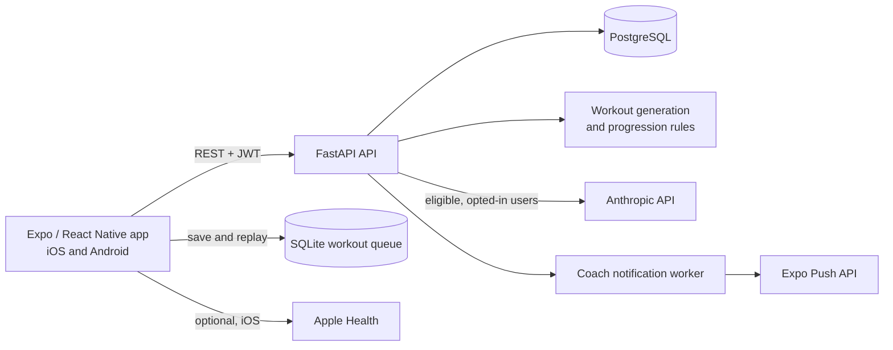

# PrimeRepAI

**Strength training that adapts to the person doing it.** PrimeRepAI is an iOS and Android fitness coaching app built with React Native and Expo. It turns a user's goals, experience, schedule, available equipment, and completed workouts into a training plan they can actually follow.

This repository contains the mobile client. A separate [FastAPI backend](https://github.com/DiegoZG/PrimeRep-AI-Backend) handles authentication, workout generation, exercise data, coaching, and persistence.

## What you can do

- **Train with a plan:** Complete onboarding, receive a personalized weekly schedule, adjust workout duration, or build and activate a custom program.
- **Log the whole workout:** Record sets, reps, weights, notes, and exercise feedback; resume an unfinished session and review history, personal records, and training trends.
- **Keep training through a connection drop:** The native workout player saves drafts and pending changes in SQLite before syncing them with the API.
- **Get useful coaching:** See a Coach feed informed by progression, recovery, missed workouts, milestones, and other recorded activity. Eligible users can opt into AI-assisted guidance and push notifications.
- **Explore and customize:** Search exercises and programs, save favorites, create exercises, and choose equipment and training preferences.
- **Connect health data on iOS:** Optionally import Apple Health step and sleep summaries and export completed PrimeRep workouts after server confirmation.

## Engineering highlights

| Area | How it works |
| --- | --- |
| Personalized training | The backend generates repeatable, equipment-aware weekly plans. Weight recommendations use completed sets to suggest an increase, hold, or deload. |
| Bounded AI | Anthropic generates workout intent and exercise explanations in one request for a week of workouts. Responses are validated, and template guidance keeps plans available if the model is unavailable. The Coach feed derives its facts from application data. |
| Offline workout logging | A durable SQLite operation queue saves changes before network requests. Client operation IDs make retries safe; server-side workout snapshots and version checks protect sessions when plans or sets change. |
| Coach delivery | The backend reconciles guidance when its source data changes and delivers opted-in notifications through a PostgreSQL-backed worker with locking, retries, and receipt tracking. |



## Stack and repository layout

| Layer | Technology | Where to look |
| --- | --- | --- |
| App and navigation | React Native, Expo, Expo Router, TypeScript | [`app/`](app/) |
| Client state and offline storage | React Context, Expo SQLite | [`utils/`](utils/) |
| API and integrations | Fetch-based HTTP client, Expo notifications, Apple Health | [`services/`](services/) |
| API server and database | FastAPI, SQLAlchemy, PostgreSQL, Alembic | [PrimeRepAI backend](https://github.com/DiegoZG/PrimeRep-AI-Backend) |
| End-to-end flows | Maestro | [`.maestro/`](.maestro/) |

## Run locally

### 1. Start the backend

The app needs the companion API and PostgreSQL database. In a separate checkout of the [backend repository](https://github.com/DiegoZG/PrimeRep-AI-Backend), copy `.env.example` to `.env`, set local JWT secrets, then install dependencies, start PostgreSQL, apply migrations, and run the API:

```bash
cp .env.example .env
python3 -m venv .venv
source .venv/bin/activate
python3 -m pip install -r requirements.txt
docker compose up -d
alembic upgrade head
uvicorn app.main:app --reload
```

The API should be available at `http://127.0.0.1:8000`; interactive API documentation is at `http://127.0.0.1:8000/docs`. See the backend README for its full configuration and optional services.

### 2. Configure the mobile app

```bash
npm ci
cp .env.example .env.local
```

Set `EXPO_PUBLIC_API_URL` in `.env.local` to an address your simulator or device can reach. Use your computer's LAN IP for a physical phone; `localhost` on the phone points to the phone itself. The sample address in `.env.example` is only an example and may not work on your network.

### 3. Launch a development build

```bash
npx expo run:ios      # macOS + Xcode
# or
npx expo run:android  # Android SDK / emulator
```

After the first native build, use `npm start` to run the Expo development server. A development build is needed for native integrations such as Apple Health and push notifications; Expo Go does not provide the full native feature set. `npm run web` is useful for browser UI development, but native integrations require a device or simulator.

AI features require backend configuration and, where applicable, an eligible user who opted in. Core workout planning continues to work without an Anthropic API key.

## Checks

```bash
npm run lint
npm run typecheck
npm run test:exercise-foundation
npm run test:profile
npm run test:health-ui
```

The [Maestro guide](.maestro/README.md) covers end-to-end flows, fixtures, and native device checks. Backend API and service tests live in the companion repository.

## Platform notes

- Apple Health reading and workout export are optional iOS features and require an iOS native build and user permission.
- The Android health connection screen is present, but Health Connect syncing is not available yet.
- Production builds require `EXPO_PUBLIC_API_URL` to be set to an HTTPS endpoint. Release builds also require monitored legal and support email addresses; see [`.env.example`](.env.example).
