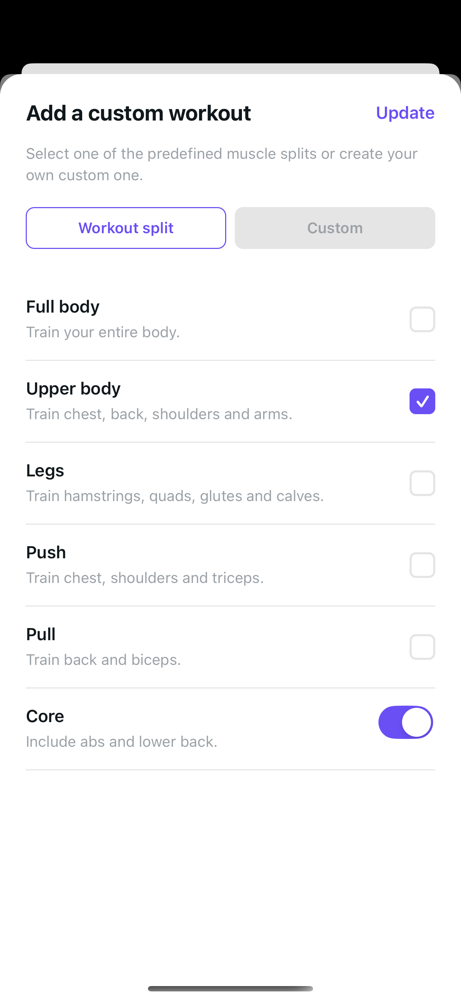
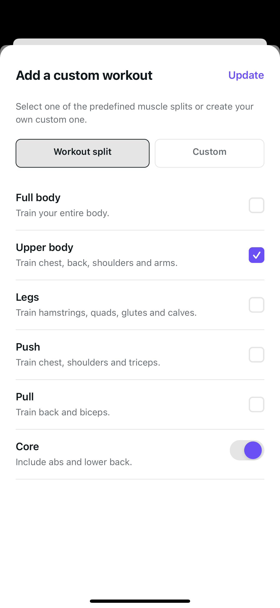
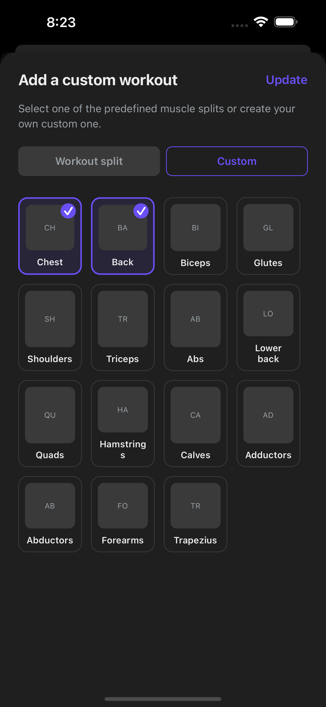
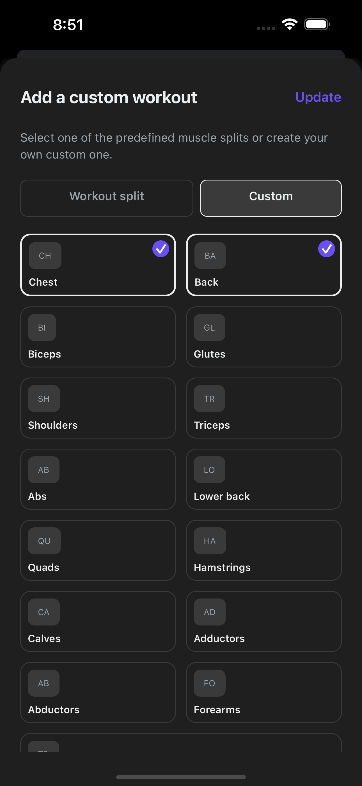
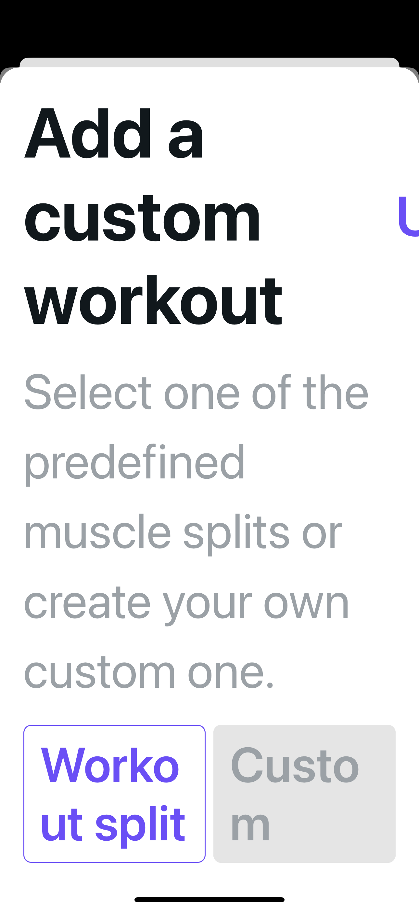
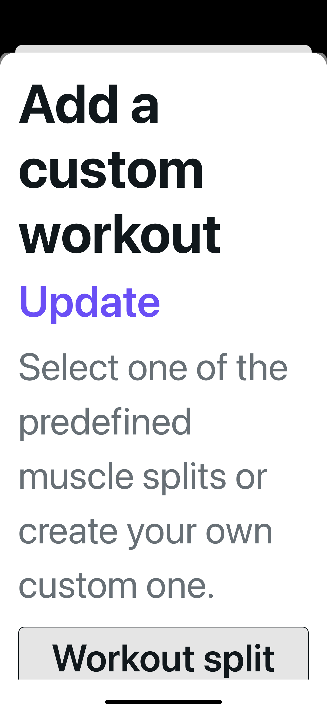
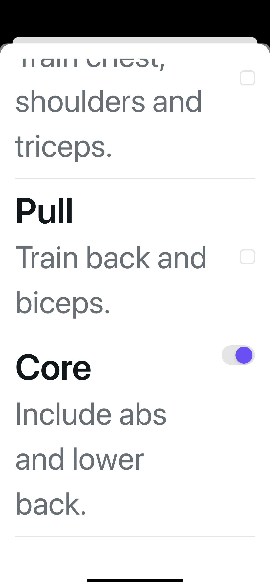

# Add-workout modal refinement

Quieter mode controls and custom tiles keep selection checks and Add/Update
meaningful. The existing scroller now includes the wrapping header and controls;
readable text stays uncapped. The saved-Core fix and all selection/payload logic
are unchanged. Empty Add/Update remains faded but enabled.

Seven unedited simulator PNGs cover three iPhone 16 Plus scenarios (iOS 18.5).
“Normal” is the OS Large category; MAX is Accessibility Extra Extra Extra Large.
Exact source, image hashes, dimensions and methods: [provenance.json](provenance.json).

## Light · normal · saved Upper body + Core

| Before | After |
| --- | --- |
|  |  |

Upper body and Core remain selected; Update was not pressed.

## Dark · normal · temporary Chest + Back

| Before | After |
| --- | --- |
|  |  |

Temporary selections were dismissed without Update. The last Trapezius tile
extends below the after viewport; this is not an all-15-in-one-frame claim.

## Light · MAX · header and reachable Core

| Before top | After top |
| --- | --- |
|  |  |

The before endpoint was unreachable and has no matched bottom image. Final plain
body dragging moved the sheet content and reached the actual Core endpoint.
Only a shallow 0→11→0 reverse was accepted with Update visible and the sheet open:
three fast full reverse drags instead natively dismissed to the unchanged parent.

## Verification and limits

Local author and independent checks each passed 79 focused contracts within one
1,758-test standard run, actual typecheck, audits and a 62-page web export with
15 exact-source modules. Lint: zero errors, two inherited warnings. These are not
CI results. The source commit was created after native capture; file hashes prove
capture equivalence, not a post-commit runtime restart.

No Add/Update, API persistence, compact SE, full theme/font matrix, keyboard,
VoiceOver or physical-device certification. Core's native 51×31-point visual frame
is not an independently measured 44-point target. No dependencies, migration or
shared theme changes.
