# U38 · Download my data

The download tile and success badge use quieter existing neutral colors. The sole archive action and meaningful success check remain purple. Four paint values change; copy, sizing, layout, shared profile UI and archive behavior stay unchanged.

These 20 unmodified canonical screenshots pair five configurations at the top and actual footer endpoint. Exact SHA-256 hashes, bytes, dimensions and capture qualifications are in [provenance.json](provenance.json). Success is not pictured: no native archive action was pressed.

## Plus · normal text

The top comparisons show the quieter decorative tile in both themes. The Light footer shows the unchanged primary action and private-information warning after scrolling; the action is not pinned or activated.

| Original | Candidate |
| --- | --- |
| 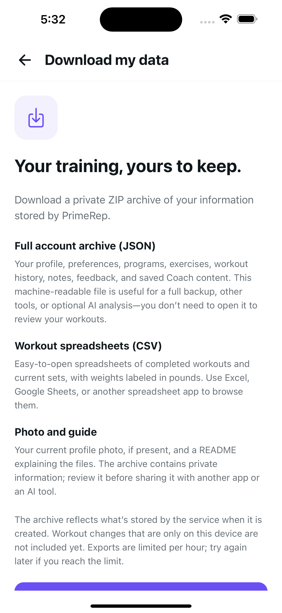 | 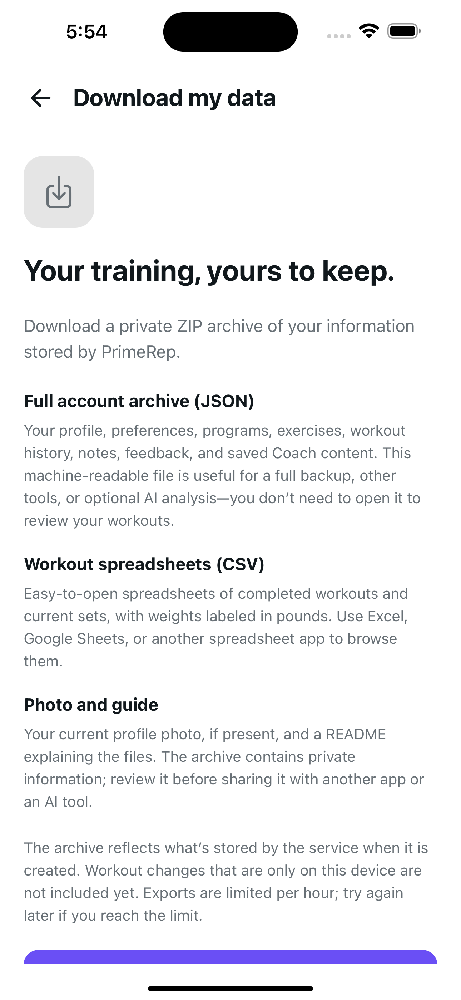 |
| 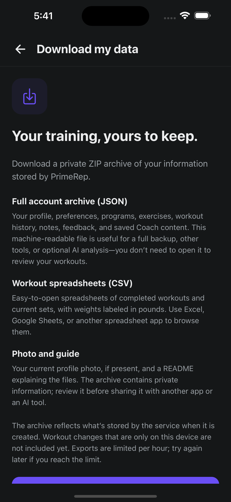 | 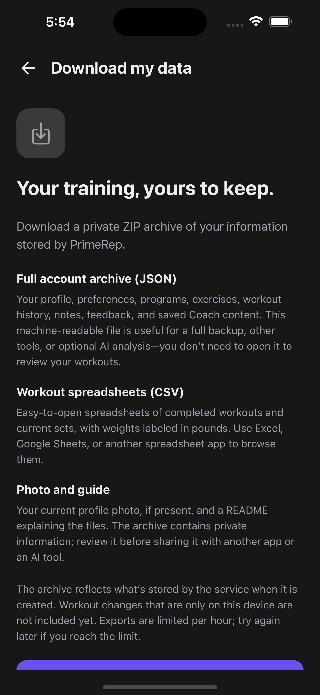 |
| 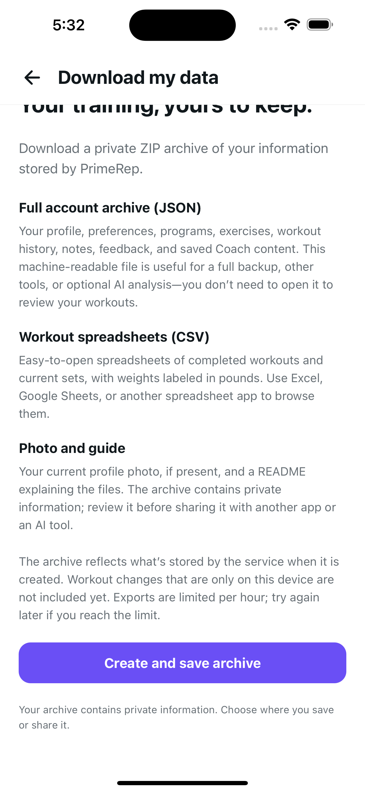 |  |

Remaining seven before/after pairs

| Configuration / position | Original | Candidate |
| --- | --- | --- |
| Plus Dark normal footer | 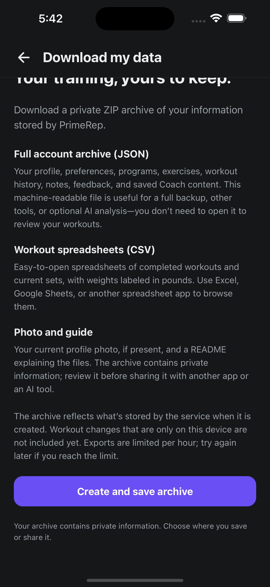 |  |
| SE Light normal top | 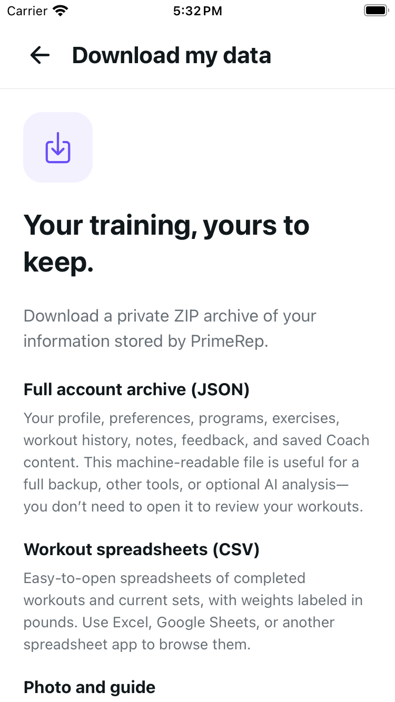 | 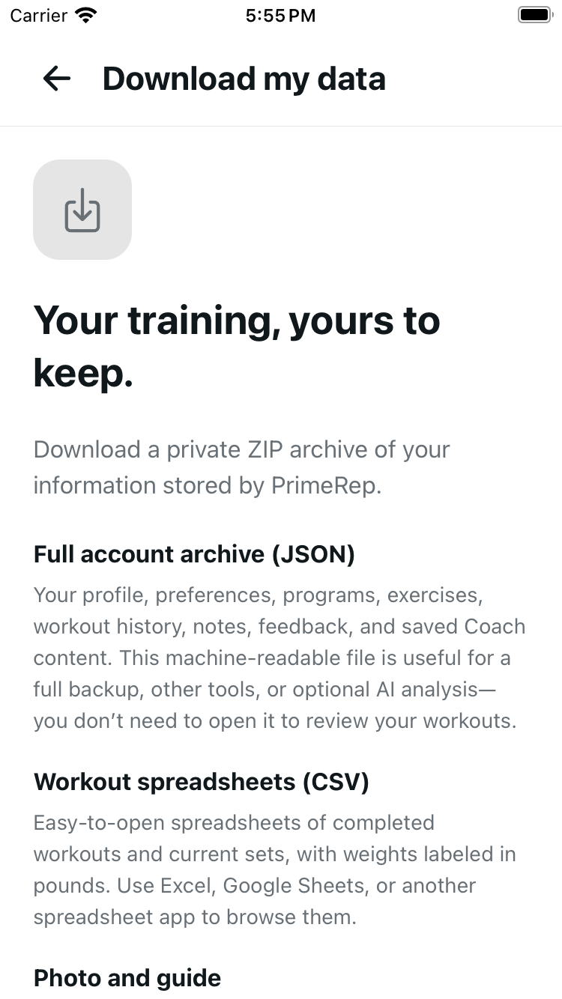 |
| SE Light normal footer |  | 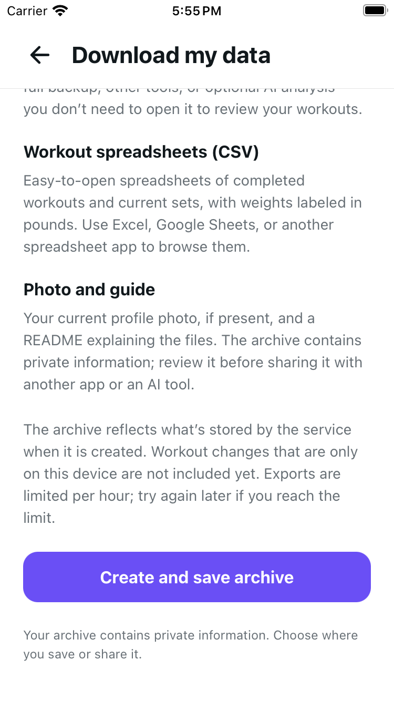 |
| SE Light MAX top | 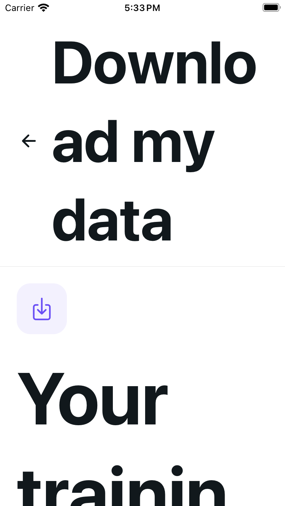 | 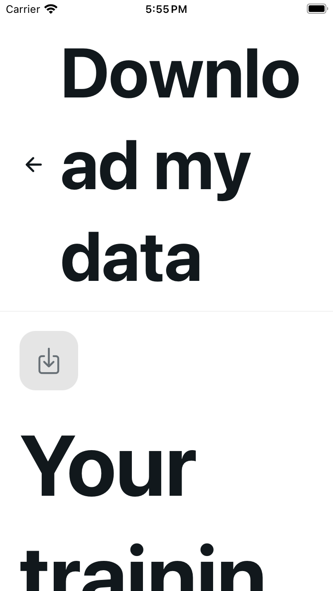 |
| SE Light MAX footer |  |  |
| SE Dark MAX top | 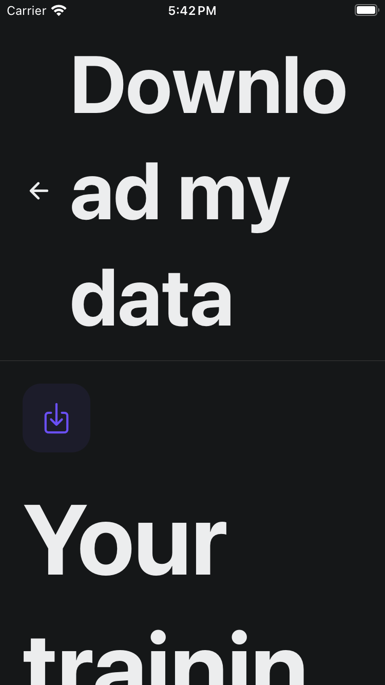 |  |
| SE Dark MAX footer | 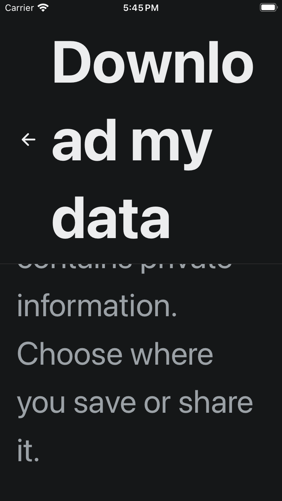 |  |

## Method and limits

Before and after are paired by device class, theme, OS text size and top/footer position, not identical scroll gestures. Original captures reuse an existing development runtime whose whole tracked tree exactly equals the merged base; this is not a fresh original Metro start or rebuilt client. Both sets use five cold-metric configurations with public installed-client reconnects. Candidate MAX footer endpoints are verified from pixels showing the final privacy line and bottom padding after body-contained gestures, not from a 100% accessibility value or numeric target bounds.

The shared ProfilePage MAX header remains unchanged. On SE MAX it occupies about half the screen; the final warning is taller than the body, and the archive action is above the viewport at the actual bottom. This paint change makes no all-fit, CTA-discovery or shared-header improvement claim. The shared issue belongs to the separate U35b follow-up.

Native captures are read-only. No archive creation, destination save/share, Back activation, busy/error/success, keyboard, VoiceOver, Android or physical-device acceptance is claimed. Success colors, timers, errors and reduced-motion configuration are tested through an explicitly mocked renderer, not native export or OS-motion execution.

## Local verification

- 35 focused tests, retaining 32 original contracts plus three bounded paint cases; 18 foundation tests.
- Author and independent reviewer each passed one 1,630-test standard run; author also passed 14 Health/offline tests.
- UI-action audit/self-tests, syntax, scoped lint and diff checks pass. Project lint: zero errors, two inherited hook warnings.
- Fresh-process web export: 62 HTML pages and 14 exact emitted source modules, including the web private-file service.
- Types intentionally skipped because imports/types are unchanged, per repository instructions. These are local checks, not CI.

Source base is `579d777c`; source milestone is `6962e45e`, with unchanged captured source bytes. No separate post-commit runtime restart or capture is claimed.

The imports, controller, readable copy, primary action and all 20 shared/host/config pins remain exact. An inverse-paint assertion reconstructs the entire original route. Existing renderer-only focus/unit timing and share-dismissal qualifications remain unchanged; no correctness fix, new dependency, configuration, provider, service or rollout flag is included.
