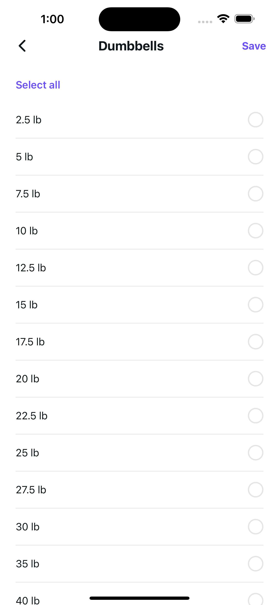
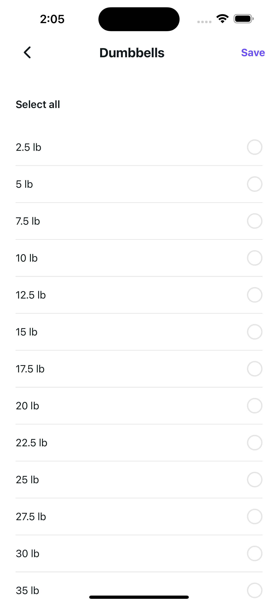
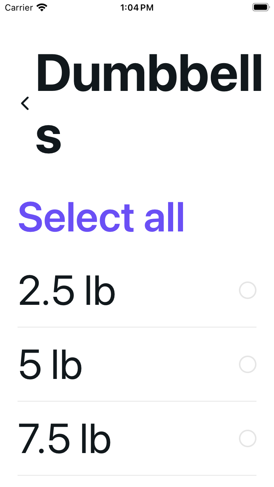
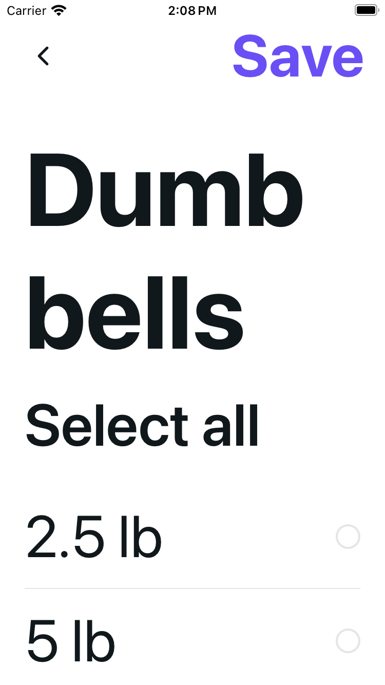
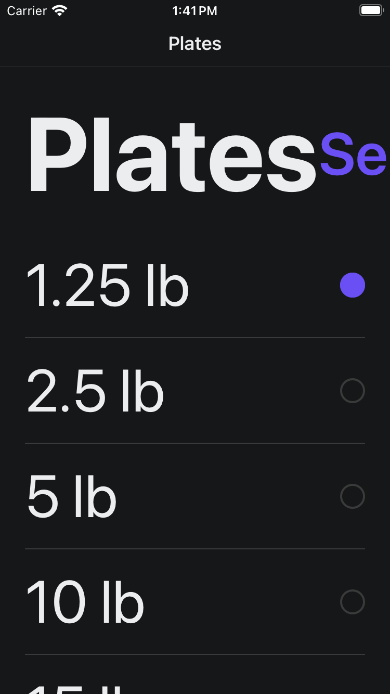
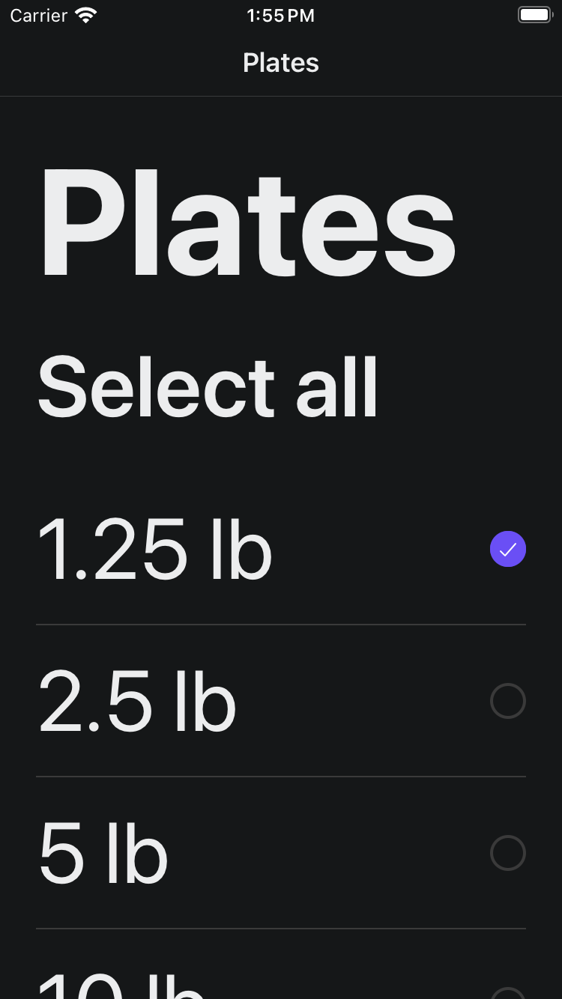

# Equipment weights — calmer controls, readable large text

One shared editor serves four separately recorded screens: U36 Settings dumbbells, U37 Settings plates, U42 onboarding dumbbells and U43 onboarding plates. Options, lb labels, selection/data behavior, Save/error/busy logic and the onboarding native Stack are unchanged.

Select/Deselect all is neutral with a real 44pt minimum target. Settings Back/Save follows safe-area insets, and large text puts the complete title in the list scroller. Onboarding stacks its body heading and bulk action at large text sizes. Purple still marks Save and meaningful selected weights. Rows expose accurate checkbox state; the decorative check stays visible without capping body text.

## Before / after

U36 · Plus Light normal: Select all becomes neutral with an actual 44pt minimum target. Save stays purple; the Settings header now uses safe-area insets.

| Original | Candidate |
| --- | --- |
|  |  |

U36 · SE Light MAX: the original title/action overflow is replaced by a full wrapping title in the scroller and a visible fixed Save action. Endpoint images below show the title scrolling away.

| Original | Candidate |
| --- | --- |
|  |  |

U43 · SE Dark MAX: the known 1.25lb selection remains purple with a visible white check; the neutral bulk action no longer competes with the body heading. Both frames use direct/no-Back entry, not parent-navigation acceptance.

| Original | Candidate |
| --- | --- |
|  |  |

## What was checked

There are 16 matched body/theme/font configurations and 32 canonical PNGs per version. Settings uses Plus normal and SE MAX; onboarding uses SE normal/MAX, each in Light/Dark.

| Version | Settings | Guest via actual parent | Guest direct, no Back |
| --- | --- | --- | --- |
| Original | 8 | 5 | 3 |
| Candidate | 8 | 2 | 6 |

Body axes, selected values and pixel dimensions match; entry methods are not assumed equivalent. The unchanged equipment parent's Edit hit path was partly occluded in some cases, so explicitly approved direct entry completed body comparisons. Those cases are not parent-navigation or Back passes. Candidate captures used cold reconnects; the original used mixed methods, with Settings cold/warm not individually itemized. No 16 matched cold-start/navigation passes or hot font-transition certification is claimed.

Original guest setup selected 2.5lb dumbbell and 1.25lb plate once. Candidate made no weight-row, bulk, Save or Back changes. Settings remained unselected. The same disposable sign-in was restored through ordinary public login afterward; no private storage/auth injection, manual logout/draft cleanup or storage-verification pass is claimed. Runtime lifecycle is managed separately and no shutdown is inferred here.

## Verification and boundaries

118 focused tests retain all 70 original cases. Two full 1,595-test runs pass on frozen source; independent verification is accepted, and focused cases overlap full totals. Types, syntax, scoped lint, UI-action audit/self-tests and diff checks pass. Project lint has zero errors and two inherited hook warnings. A fresh isolated-cache web export produced 62 HTML routes with 14 relevant emitted source modules matching exact source bytes. These are local checks, not CI certification.

Original controllers/options, reconstructed original imports, all four hosts, providers, services, theme and shared animation remain exact. [Provenance](provenance.json) records source milestone, source/runtime/capture hashes, dimensions, per-case entry qualifications and preservation pins.

Native Save, bulk selection, Back activation, persistence, keyboard flow, VoiceOver audio, physical-device and Android verification are not claimed. Public accessibility bounds/checked states do not certify VoiceOver. First/last-row captures do not certify every intermediate glyph or all controls fitting simultaneously. Inherited renderer-only late callbacks/compiler-transform findings and the separate parent hit-path issue were not fixed here. Supplementary/setup/auth images and private diagnostics are excluded.

All 16 configurations — top and last-row pairs (64 canonical images)

| Case | Top | Last-row endpoint | Selected values | Guest entry: before → after |
| --- | --- | --- | --- | --- |
| U36 · Plus light normal | [Before](original-u36-plus-light-normal-top.png) / [After](candidate-u36-plus-light-normal-top.png) | [Before](original-u36-plus-light-normal-bottom.png) / [After](candidate-u36-plus-light-normal-bottom.png) | none | Settings → Settings |
| U36 · Plus dark normal | [Before](original-u36-plus-dark-normal-settled-top.png) / [After](candidate-u36-plus-dark-normal-top.png) | [Before](original-u36-plus-dark-normal-bottom.png) / [After](candidate-u36-plus-dark-normal-bottom.png) | none | Settings → Settings |
| U36 · SE light MAX | [Before](original-u36-se-light-max-settled-top.png) / [After](candidate-u36-se-light-max-top.png) | [Before](original-u36-se-light-max-bottom.png) / [After](candidate-u36-se-light-max-bottom.png) | none | Settings → Settings |
| U36 · SE dark MAX | [Before](original-u36-se-dark-max-verified-top.png) / [After](candidate-u36-se-dark-max-top.png) | [Before](original-u36-se-dark-max-bottom.png) / [After](candidate-u36-se-dark-max-bottom.png) | none | Settings → Settings |
| U37 · Plus light normal | [Before](original-u37-plus-light-normal-settled-top.png) / [After](candidate-u37-plus-light-normal-top.png) | [Before](original-u37-plus-light-normal-bottom.png) / [After](candidate-u37-plus-light-normal-bottom.png) | none | Settings → Settings |
| U37 · Plus dark normal | [Before](original-u37-plus-dark-normal-settled-top.png) / [After](candidate-u37-plus-dark-normal-top.png) | [Before](original-u37-plus-dark-normal-bottom.png) / [After](candidate-u37-plus-dark-normal-bottom.png) | none | Settings → Settings |
| U37 · SE light MAX | [Before](original-u37-se-light-max-settled-top.png) / [After](candidate-u37-se-light-max-top.png) | [Before](original-u37-se-light-max-bottom.png) / [After](candidate-u37-se-light-max-bottom.png) | none | Settings → Settings |
| U37 · SE dark MAX | [Before](original-u37-se-dark-max-verified-top.png) / [After](candidate-u37-se-dark-max-top.png) | [Before](original-u37-se-dark-max-bottom.png) / [After](candidate-u37-se-dark-max-bottom.png) | none | Settings → Settings |
| U42 · SE light normal | [Before](original-u42-se-light-normal-parent-verified-top.png) / [After](candidate-u42-se-light-normal-parent-top.png) | [Before](original-u42-se-light-normal-parent-bottom.png) / [After](candidate-u42-se-light-normal-parent-bottom.png) | 2.5 lb | parent → parent |
| U42 · SE dark normal | [Before](original-u42-se-dark-normal-parent-verified-top.png) / [After](candidate-u42-se-dark-normal-direct-top.png) | [Before](original-u42-se-dark-normal-parent-bottom.png) / [After](candidate-u42-se-dark-normal-direct-bottom.png) | 2.5 lb | parent → direct/no Back |
| U42 · SE light MAX | [Before](original-u42-se-light-max-parent-verified-top.png) / [After](candidate-u42-se-light-max-direct-top.png) | [Before](original-u42-se-light-max-parent-bottom.png) / [After](candidate-u42-se-light-max-direct-bottom.png) | 2.5 lb | parent → direct/no Back |
| U42 · SE dark MAX | [Before](original-u42-se-dark-max-direct-verified-top.png) / [After](candidate-u42-se-dark-max-direct-top.png) | [Before](original-u42-se-dark-max-direct-bottom.png) / [After](candidate-u42-se-dark-max-direct-bottom.png) | 2.5 lb | direct/no Back → direct/no Back |
| U43 · SE light normal | [Before](original-u43-se-light-normal-parent-verified-top.png) / [After](candidate-u43-se-light-normal-parent-top.png) | [Before](original-u43-se-light-normal-parent-bottom.png) / [After](candidate-u43-se-light-normal-parent-bottom.png) | 1.25 lb | parent → parent |
| U43 · SE dark normal | [Before](original-u43-se-dark-normal-parent-verified-top.png) / [After](candidate-u43-se-dark-normal-direct-top.png) | [Before](original-u43-se-dark-normal-parent-bottom.png) / [After](candidate-u43-se-dark-normal-direct-bottom.png) | 1.25 lb | parent → direct/no Back |
| U43 · SE light MAX | [Before](original-u43-se-light-max-direct-verified-top.png) / [After](candidate-u43-se-light-max-direct-top.png) | [Before](original-u43-se-light-max-direct-bottom.png) / [After](candidate-u43-se-light-max-direct-bottom.png) | 1.25 lb | direct/no Back → direct/no Back |
| U43 · SE dark MAX | [Before](original-u43-se-dark-max-direct-verified-top.png) / [After](candidate-u43-se-dark-max-direct-top.png) | [Before](original-u43-se-dark-max-direct-bottom.png) / [After](candidate-u43-se-dark-max-direct-bottom.png) | 1.25 lb | direct/no Back → direct/no Back |

