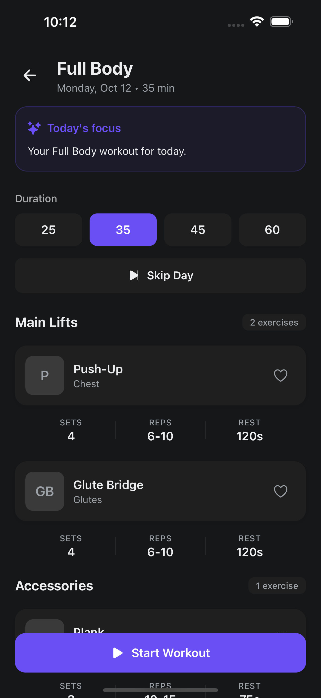
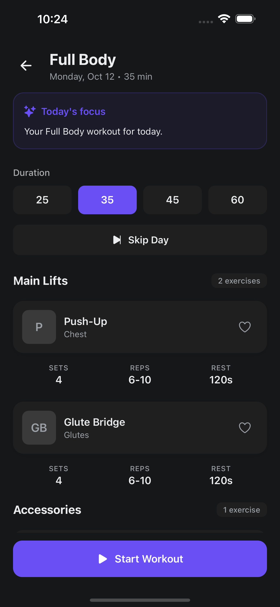
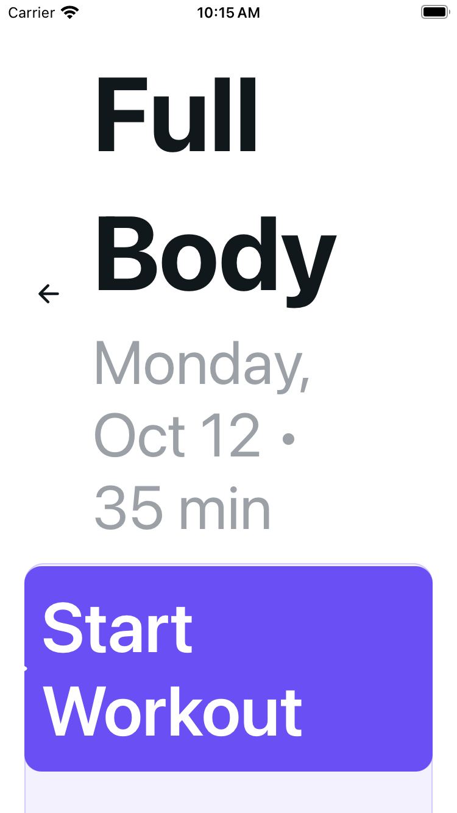
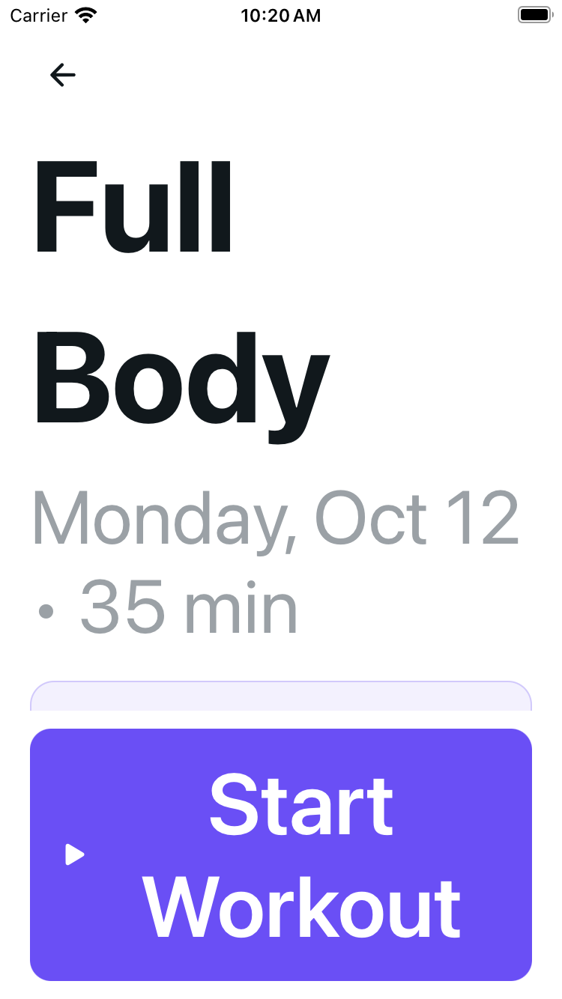
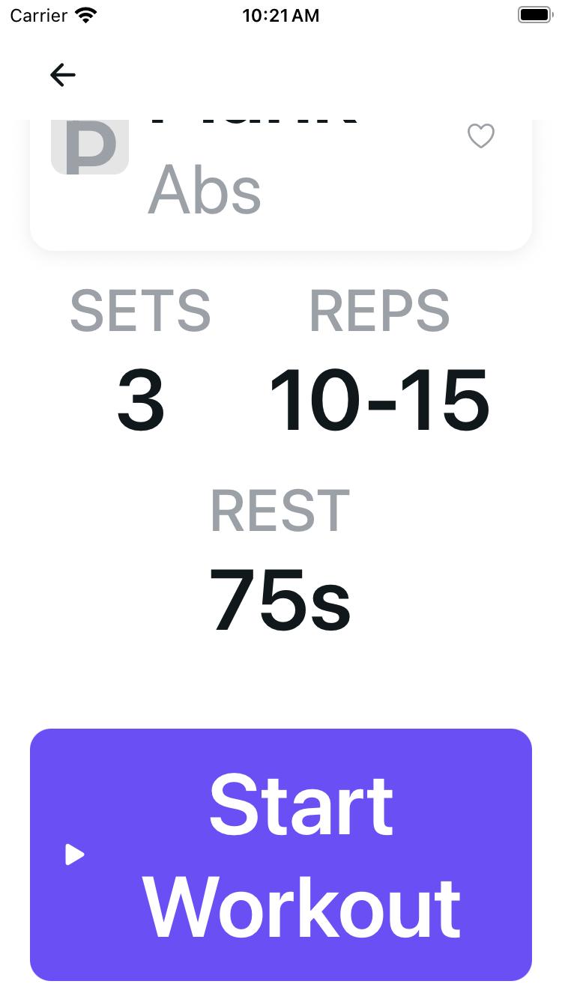
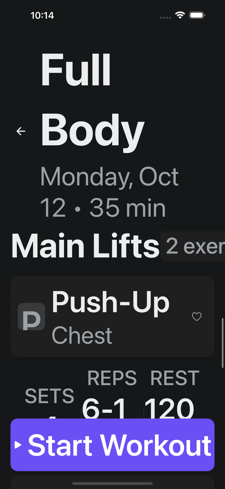
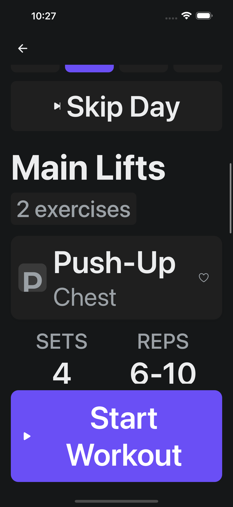

# Workout Detail: scalable layout

An in-flow safe-area footer keeps Start below the list. Enlarged loaded headings scroll with the body while Back stays fixed; prescription fields and section counts wrap naturally. Existing fonts, palette, copy, values and business behavior remain unchanged. Named buttons and selected minute choices expose clearer public accessibility metadata.

## Source and verification

Original base `b630bd7dec5c0f839aa29b88c9f18c6229687f58`; source commit `338863a580d75ace0b575fabf6f023754626e507`. Exact source pins, PNG hashes, dimensions and individual captions are in [provenance.json](provenance.json).

Author and independent checks passed: 74 focused / 100 affected / 1,103 full tests, types, scoped lint, normal lint (two existing unrelated warnings), UI action audit/self-test and fresh 62-HTML export with exact emitted modules. No tests skipped. The original 9,605-byte controller remains byte-exact; removing only the presentation import restores the exact helper/import prefix. A stale whole-route test now checks its exact ContentSection import and non-empty exact invocations; all other caller/controller guards remain intact.

No auth/provider/service/shared-theme/logging/Health/API/storage/dependency changes. Existing initial-fetch-error, historical-week and disabled/busy controller quirks are not fixed.

## Cold native comparisons

iOS 18.5 / Expo SDK 54, five matched configurations. Normal means public content size `large`; MAX means `accessibility-extra-extra-extra-large`. The existing client was reconnected cold after each public appearance/text-size change to avoid stale geometry. Only fictional UI fixture data is shown. All 30 PNGs are copied byte-exact without cropping or editing.

Initial frames show the opening viewport. Bottom frames show a settled scrolled position; the original SE supplement is only a bounded scroll attempt, not a reached prescription bottom.

| Configuration | Original initial | Original bottom/attempt | Candidate initial | Candidate bottom |
| --- | --- | --- | --- | --- |
| Plus Light normal | [Initial](cold-plus-light-large-workout-initial.png) | [Bottom](cold-plus-light-large-workout-bottom.png) | [Initial](plus-light-large-stable-initial.png) | [Bottom](plus-light-large-stable-bottom-stable.png) |
| Plus Dark normal | [Initial](cold-plus-dark-large-workout-initial.png) | [Bottom](cold-plus-dark-large-workout-bottom.png) | [Initial](plus-dark-large-initial.png) | [Bottom](plus-dark-large-bottom-stable.png) |
| Plus Light MAX | [Initial](cold-plus-light-max-workout-initial.png) | [Bottom](cold-plus-light-max-workout-bottom.png) | [Initial](plus-light-max-stable-initial.png) | [Bottom](plus-light-max-stable-bottom-stable.png) |
| Plus Dark MAX | [Initial](cold-plus-dark-max-workout-initial.png) | [Bottom](cold-plus-dark-max-workout-bottom.png) | [Initial](plus-dark-max-initial.png) | [Bottom](plus-dark-max-bottom-stable.png) |
| SE Light MAX | [Initial](cold-se-light-max-workout-initial.png) | [Bounded attempt](cold-se-light-max-workout-scroll-attempt.png) | [Initial](se-light-max-initial.png) | [Bottom](se-light-max-bottom.png) |

Plus Dark normal — original initial, then candidate initial:

SE Light MAX — original initial, candidate initial, then candidate settled bottom (different scroll position):

## Section/count supplements

These establish section/count readability, not fixed-layer presence in every intermediate frame.

| Configuration | Main Lifts | Accessories |
| --- | --- | --- |
| Original Plus Dark MAX | [Main](cold-plus-dark-max-main-header.png) | [Accessories](cold-plus-dark-max-accessories-header.png) |
| Candidate Plus Light MAX | [Main](plus-light-max-stable-main-header.png) | [Accessories](plus-light-max-stable-accessories-header.png) |
| Candidate Plus Dark MAX | [Main](plus-dark-max-main-header.png) | [Accessories](plus-dark-max-accessories-header.png) |
| Candidate SE Light MAX | [Main](se-light-max-stable-main-header.png) | [Accessories](se-light-max-accessories-heading-count.png) |

Plus Dark MAX Main Lifts/count — original, then candidate:

## Bounded results and limits

Cold original normal final values are clear. Original MAX fields split ranges/durations across digit lines and section counts clip horizontally; the cold final digit is visible with virtually no footer clearance, **not cold final-digit occlusion**. Original compact MAX initial/four-swipe frames expose no exercise/prescription body; this is not proof against every possible scroll gesture.

Candidate bounded scrolling reaches final `3 / 10-15 / 75s` above the reserved footer in all five configurations. Examined MAX fields also show full `6-10` and `120s`; full Main Lifts/`2 exercises` and Accessories/`1 exercise` are reachable. On SE, Accessories naturally wraps as `Accessorie` / `s`, with the count following; it is not horizontally truncated. Existing shared exercise-row MAX ellipsis remains unchanged and outside this slice. These observations do not certify every title, every frame or an entire card fitting at once.

Public native metadata exposed named Back, Skip and Start buttons; duration buttons were named in minutes, with 35 minutes selected and the others unselected. This is not a VoiceOver session. No native Start, Skip, duration, favorite, exercise, session, Health or notification action was invoked.

One separately authorized named Back tap returned to [Home](plus-normal-back-home.png); the same detail was [reopened publicly](plus-normal-back-detail-return.png) with Start visible. No workout mutation was invoked.

History, warm/exploratory/transient images, permission/probe/failed diagnostics and private credentials/runtime inventories/logs/reports are excluded. No physical-device, Android, CI or native Start-behavior claim. The fictional UI fixture is retained for the separately authorized next slice; the U29 Expo listener stopped before serving new source. Final fixture logout, usual-app guest restoration and temporary cleanup remain pending, not claimed complete.
