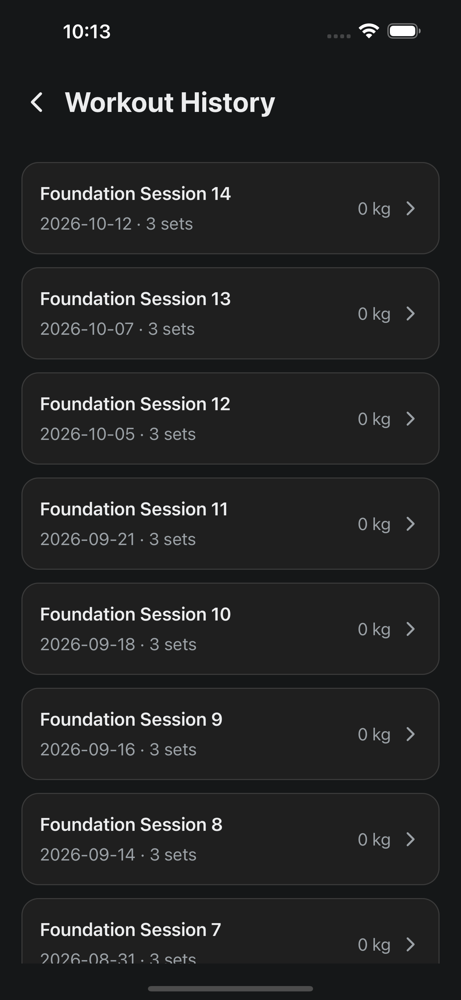
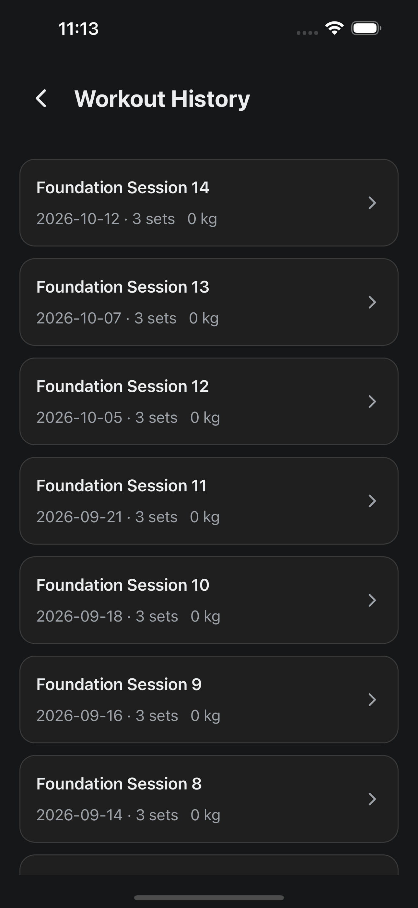
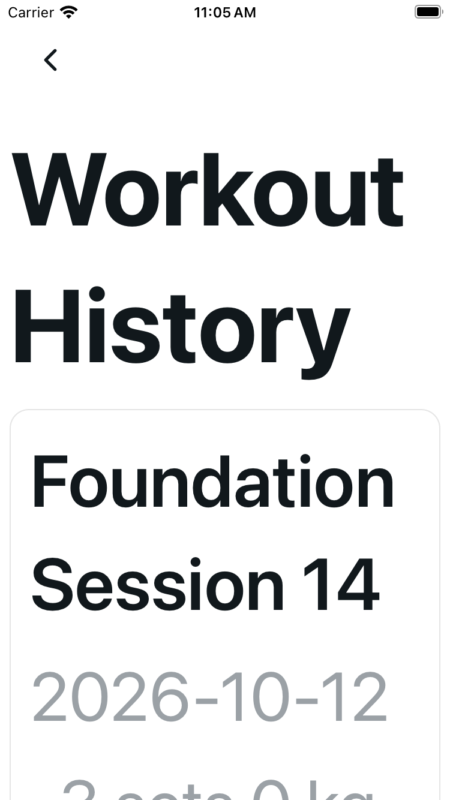
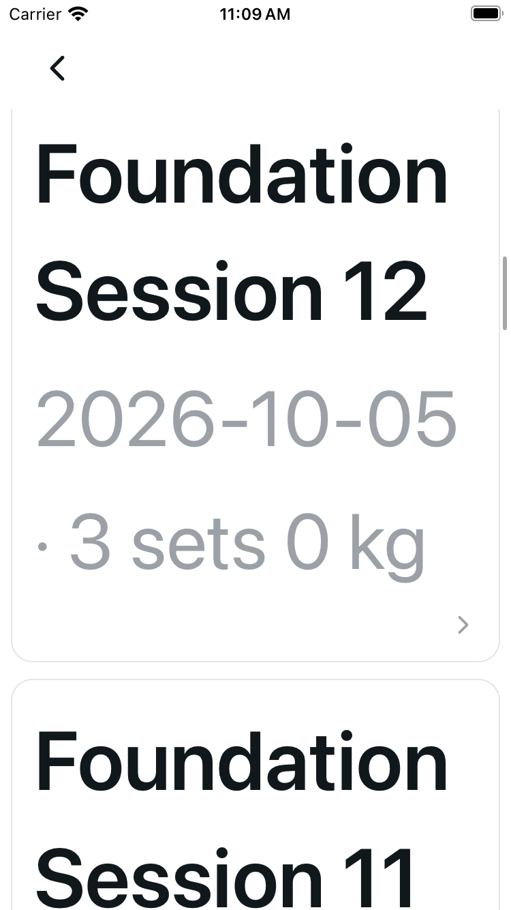

# Workout History: readable enlarged details

History retains its existing list and palette. Retry is a neutral named button; session rows have full button names. The page heading uses scalable 24-point text, and enlarged headings scroll with the body while Back stays fixed. At enlarged text sizes, saved titles and wrapping date/count/volume use the card's full width, with the decorative chevron below.

## Source and engineering

Base `b630bd7dec5c0f839aa29b88c9f18c6229687f58`; source commit `cc598a7ae4f77de6783e8f68542d0ce9f2c653eb`. Exact source pins, PNG hashes, dimensions and individual position/captions are in [provenance.json](provenance.json).

Author and independent checks pass: 37 focused and 1,066 full tests in both commands, no skips; types; scoped lint; project lint with two inherited hook warnings; UI audit/self-test; whitespace; and fresh clear 62-HTML export with four exact raw emitted source modules. The original 661-byte load/focus/auth controller remains byte-exact; removing only the UI import restores its original prefix.

An additional broader `eslint .` scan reports an inherited `Buffer` no-undef error in unchanged `scripts/test-apple-health-adapter.mjs` and 11 unrelated warnings. The project's normal `npm run lint` passes with two existing warnings. No unrelated lint fix is included.

Only the History route and its focused harness change. Providers, services, shared text/theme, API/storage, dependencies, logging and Health remain unchanged. Literal ISO dates, `sets` grammar, rounded `kg`, response order, session routes and test IDs are retained; no pagination or unit conversion is added.

## Matched cold comparison

iOS 18.5 / Expo SDK 54; normal means public content size `large`, MAX means `accessibility-extra-extra-extra-large`. Cold reconnects used the approved existing Plus and SE simulators and fictional fixture only. All 22 PNGs are byte-exact copies without cropping or editing: five originals, 15 revised matrix frames and two separate navigation frames.

Initial frames show the opening History viewport. Scroll supplements and later frames are different list positions, not whole-card one-frame fit claims. The Plus MAX first scroll supplements show **Session 13**, not a complete Session 14; preceding metadata can be clipped at the viewport boundary.

| Configuration | Original initial | Revised initial | Revised scroll supplement | Revised later |
| --- | --- | --- | --- | --- |
| Plus Light normal | [Original](cold-plus-light-large-history.png) | [Initial](revised-plus-light-large-initial.png) | [Metadata supplement](revised-plus-light-large-first-metadata.png) | [Session 1](revised-plus-light-large-later-stable.png) |
| Plus Dark normal | [Original](cold-plus-dark-large-history.png) | [Initial](revised-plus-dark-large-initial.png) | [Metadata supplement](revised-plus-dark-large-first-metadata.png) | [Session 1](revised-plus-dark-large-later-stable.png) |
| Plus Light MAX | [Original](cold-plus-light-max-history.png) | [Initial](revised-plus-light-max-initial.png) | [Session 13 metadata](revised-plus-light-max-first-metadata.png) | [Session 10](revised-plus-light-max-later-stable.png) |
| Plus Dark MAX | [Original](cold-plus-dark-max-history.png) | [Initial](revised-plus-dark-max-initial.png) | [Session 13 metadata](revised-plus-dark-max-first-metadata.png) | [Session 10](revised-plus-dark-max-later-stable.png) |
| SE Light MAX | [Stable original](cold-se-light-max-history-stable.png) | [Initial](revised-se-light-max-initial.png) | [Session 14 metadata](revised-se-light-max-first-metadata.png) | [Session 12](revised-se-light-max-later-row.png) |

Plus Dark normal, original then revised initial:

SE Light MAX, stable original, revised initial, then revised later Session 12 (different scroll position):

## Bounded observations and navigation

Original normal views are readable. Original Plus MAX breaks the first title/date beside volume; stable original SE MAX clips the page heading and exposes title fragments. Revised normal views preserve calm structure and show complete Session 14 initial values and Session 1 later metadata. Revised MAX captures show intact Workout/History and Foundation/Session 14 words and the ISO date. Scroll supplements make complete date/count/kg reachable; Plus MAX supplements show Session 13 metadata, later frames show Session 10, and SE's later frame shows Session 12 / `2026-10-05` / `3 sets` / `0 kg`.

Public accessibility metadata exposes named Back and 14 session buttons with complete title/date/count/kg names; decorative chevrons are excluded. This is not a VoiceOver session. No session row was opened. Retry/error/empty states are engineering-covered, not a native Retry or error-state acceptance claim.

One separately authorized named Back tap returned to [Home](revised-plus-light-large-nav-back-home.png). The public View workout history action then reopened [stable History](revised-plus-light-large-nav-later-stable.png). No session or workout mutation was invoked.

## Limits and runtime boundary

Five matched configurations establish bounded value visibility and reachability, not every frame/session or whole-card one-frame fit at MAX. Existing mounted-route missing-token loading, cached rows after token removal and late old-account response overwrite remain unchanged; renderer probes are not an app-level account-isolation pass.

Workout Detail, first-draft, duplicate/transition/warm/debug/private frames, credentials, probes, runtime inventories and logs are excluded. No physical-device, VoiceOver, Android, GitHub CI or native session-row action claim.

The owned U30 Expo listener was stopped after the accepted matrix/navigation checks. Fictional auth and the isolated fixture API are retained for the next gated audit; final fictional logout, usual-app guest restoration and scoped cleanup remain pending. No cleanup-complete claim.
