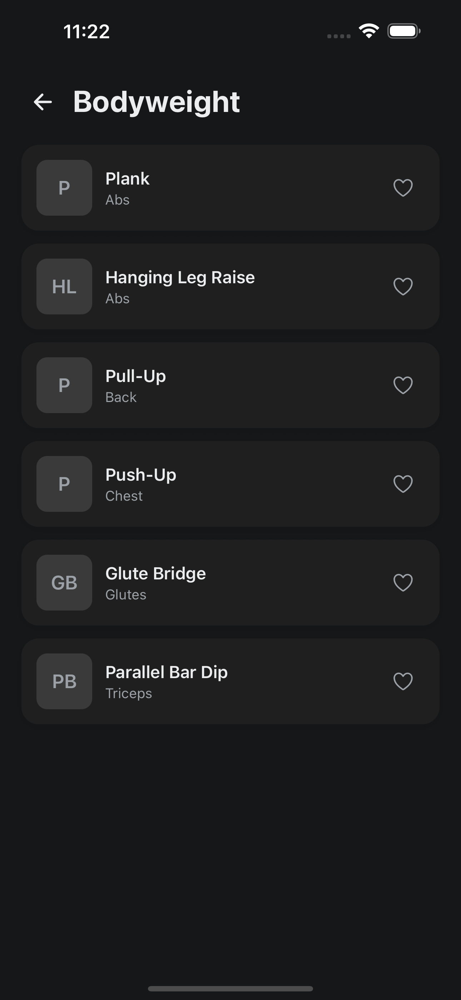
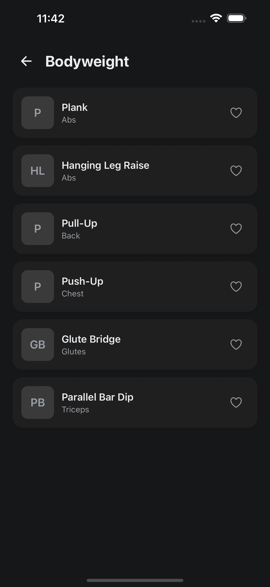
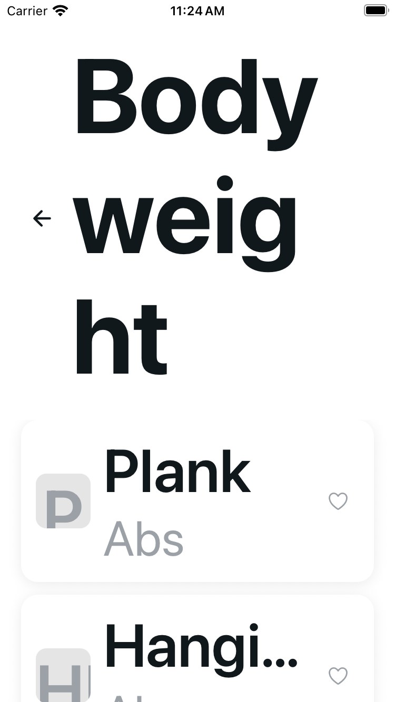
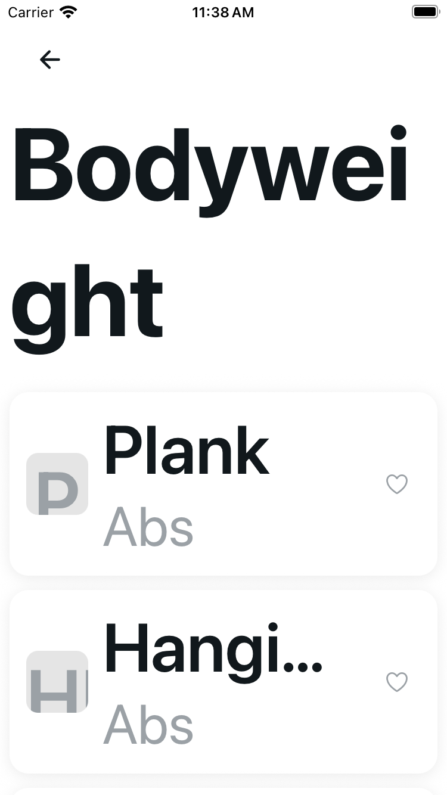
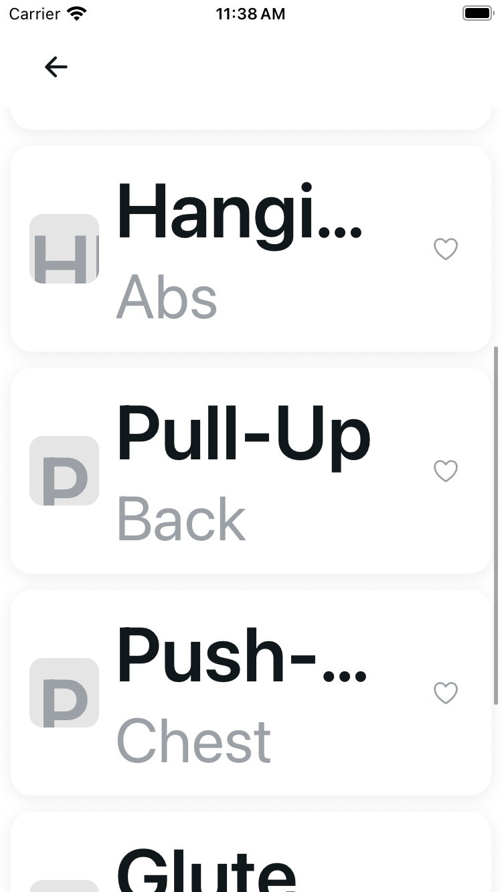

# Exercise Category: scalable heading and neutral recovery

The same fully scalable 24-point heading applies at normal and enlarged sizes. Above fontScale 1.3, exact category text scrolls with the list or loading/error body while named 44-point Back stays fixed. Retry is neutral bordered icon/text with a full button name and minimum 44-point target. The existing pagination footer receives only a route-local neutral palette, and bottom safe area is respected. No font caps or fit-to-text.

## Source and engineering

Base `b630bd7dec5c0f839aa29b88c9f18c6229687f58`; source commit `1677d6fbff4270481cc6466afb54eef442b30f32`. Exact source pins and all image hashes/dimensions/captions are in [provenance.json](provenance.json).

Author and independent checks passed: 43 original baseline cases retained with approved UI expectations → 57 focused / 1,086 full tests; types, scoped/project lint (two existing unrelated warnings), UI audit/self-test and clear 62-HTML export with exact emitted modules. No tests skipped. The original 5,390-byte controller remains byte-exact; removing only the two presentation imports restores the exact prefix. Shared pagination hook, ExerciseRow and CatalogPageFooter code stay byte-exact. Filter/paging/focus/favorite/account fences and routes are unchanged. No API/storage/auth/Health/program/theme/dependency changes.

## Five cold configurations

iOS 18.5 / Expo SDK 54. Normal means public content size `large`; MAX means `accessibility-extra-extra-extra-large`. Public appearance/text size was set before reconnecting the existing client cold. Only isolated fixture-account/seed-library UI data is shown. All 27 PNGs are copied byte-exact, without cropping or editing: 13 originals, 13 candidate matrix frames and one separate Back-navigation frame.

Initial Bodyweight frames show the opening viewport. Weights frames are settled captures of a different category. MAX scrolled supplements show a later position after one bounded body swipe, not a matched initial position or an exhaustive reachability test.

| Configuration | Original Bodyweight initial | Candidate Bodyweight initial | Original Weights settled | Candidate Weights settled |
| --- | --- | --- | --- | --- |
| Plus Light normal | [Initial](original-plus-light-large-bodyweight-initial.png) | [Initial](candidate-plus-light-large-bodyweight-initial.png) | [Weights](original-plus-light-large-weights-stable.png) | [Weights](candidate-plus-light-large-weights-stable.png) |
| Plus Dark normal | [Initial](original-plus-dark-large-bodyweight-initial.png) | [Initial](candidate-plus-dark-large-bodyweight-initial.png) | [Weights](original-plus-dark-large-weights-stable.png) | [Weights](candidate-plus-dark-large-weights-stable.png) |
| Plus Light MAX | [Initial](original-plus-light-max-bodyweight-initial.png) | [Initial](candidate-plus-light-max-bodyweight-initial.png) | [Weights](original-plus-light-max-weights-stable.png) | [Weights](candidate-plus-light-max-weights-stable.png) |
| Plus Dark MAX | [Initial](original-plus-dark-max-bodyweight-initial.png) | [Initial](candidate-plus-dark-max-bodyweight-initial.png) | [Weights](original-plus-dark-max-weights-stable.png) | [Weights](candidate-plus-dark-max-weights-stable.png) |
| SE Light MAX | [Initial](original-se-light-max-bodyweight-initial.png) | [Initial](candidate-se-light-max-bodyweight-initial.png) | [Weights](original-se-light-max-weights-stable.png) | [Weights](candidate-se-light-max-weights-stable.png) |

Plus Dark normal, original initial then candidate initial:

SE Light MAX: original initial, candidate initial, then candidate scrolled (different position):

## MAX body-scroll supplements

| Configuration | Original scrolled | Candidate scrolled |
| --- | --- | --- |
| Plus Light MAX | [Bodyweight](original-plus-light-max-bodyweight-scroll.png) | [Bodyweight](candidate-plus-light-max-bodyweight-scroll.png) |
| Plus Dark MAX | [Bodyweight](original-plus-dark-max-bodyweight-scroll.png) | [Bodyweight](candidate-plus-dark-max-bodyweight-scroll.png) |
| SE Light MAX | [Bodyweight](original-se-light-max-bodyweight-scroll.png) | [Bodyweight](candidate-se-light-max-bodyweight-scroll.png) |

## Bounded results and limits

Original normal headings are calm. Fixed MAX headings fragment and consume viewport; actual swipes still move the list. This is not a claim that all rows are unreachable.

Candidate Weights is whole on one line in the examined MAX frames. Bodyweight is fully present but naturally splits as `Bodyweig` / `ht` on Plus and `Bodywei` / `ght` on SE—**not whole-word fit**. One bounded swipe moves the enlarged heading away, leaves Back fixed and exposes later rows with more usable body space. Existing shared-row single-line ellipses and oversized avatar initials still clip at MAX; they are unchanged, not solved or hidden. No every-frame, every-title or whole-card fit claim.

Public native metadata exposes the named Back button and complete exercise-row button labels despite visual ellipses. Exactly one named Back tap on Plus Light normal returned actual [Home](candidate-plus-light-large-back-home.png). No exercise row, favorite, pagination, refresh, Retry, session/editor/workout/Health/notification action occurred. Public metadata is not a VoiceOver session or action certification.

Guest/no-token loading remains inherited and tested. Native error/empty/Retry was not induced; those states are mock-tested only. No physical-device, Android or CI claim. Duplicate/transient/warm images, permission/probe/debug artifacts, private reports/logs/runtime inventories, credentials and other slices are excluded.

## Runtime handoff

Owned U31 Expo listeners stopped. The fictional fixture account remains signed in and its isolated API is retained while explicit public-test logout approval is pending. No logout or guest restoration occurred during the blocked cleanup attempt; final public logout, usual-app guest restoration and temporary fixture cleanup are not claimed complete. This evidence package contains no credentials or private runtime identifiers.
