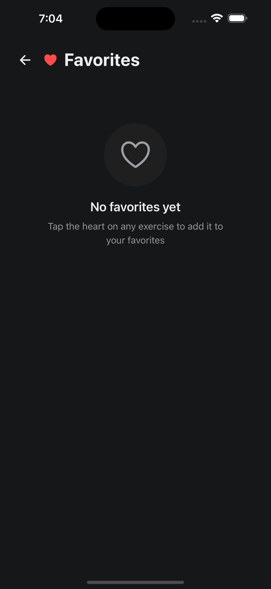
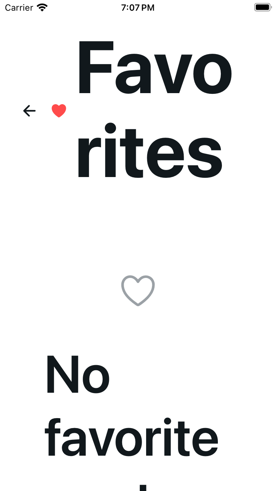
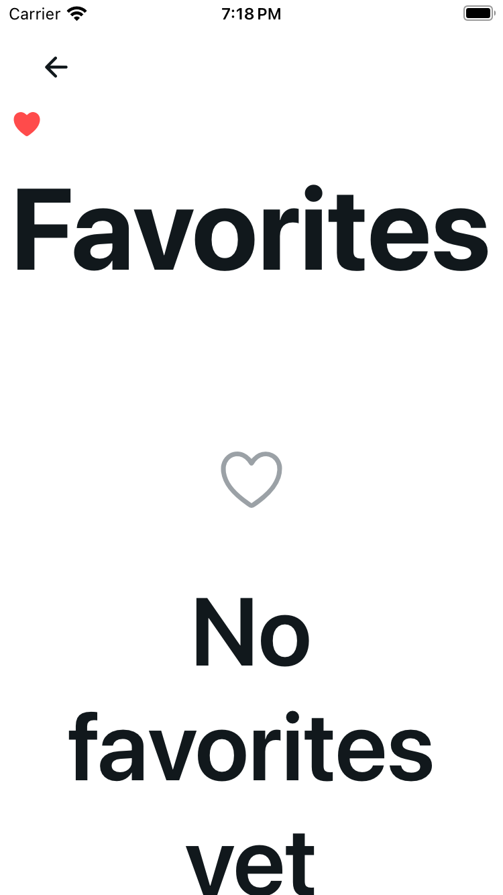
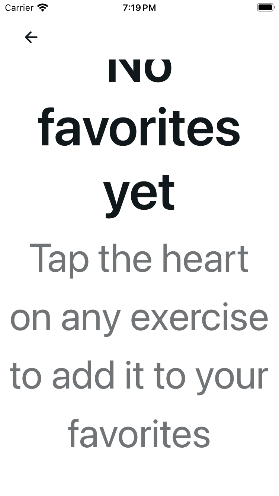

# Favorites: scalable title and readable empty copy

The same fully scalable 24-point title applies at normal and enlarged sizes. Enlarged title/red heart scroll with the body while named 44-point Back stays fixed. Empty/guest copy gets the available width; Retry is neutral named 44-point bordered icon/text. Only decorative heart glyphs are hidden from accessibility, not headings or action names. No new scaling cap or fit-to-text.

## Source and engineering

Base `68184a81870cc8ac27548c1ce29ae708ba4cd9b1`; source commit `a9dbe74cc3564a56d7354c44e474023d6567a44b`. Exact source/shared pins, native candidate bundle identity and image hashes/dimensions/captions are in [provenance.json](provenance.json).

Author and independent checks passed: 37 original cases retained with approved UI expectations → 55 focused / 1,252 full tests, types, scoped/project lint (two existing unrelated warnings), UI audit/self-test and clear 62-HTML export with exact emitted modules. No skips. The original 6,278-byte controller stays exact; removing only two presentation imports restores the original prefix. Shared row/typography/theme, services/auth/copy/focus/request/account/mutation behavior are unchanged. No API/storage/dependency changes.

## Five cold EMPTY configurations

iOS 18.5 / Expo SDK 54, existing custom client, isolated signed-in fixture with zero favorites. Normal means `large`; MAX means `accessibility-extra-extra-extra-large`. Public appearance/text size was set before reconnecting cold. All 18 canonical PNGs are copied byte-exact, without cropping or editing: nine originals, eight candidate matrix frames and one separate Back-navigation frame.

| Configuration | Original initial/settled | Original one-swipe supplement | Candidate initial/settled | Candidate one-swipe supplement |
| --- | --- | --- | --- | --- |
| Plus Light normal | [Settled](original-plus-light-large-stable.png) | Not needed | [Settled](candidate-plus-light-large-stable.png) | Not needed |
| Plus Dark normal | [Settled](original-plus-dark-large-stable.png) | Not needed | [Settled](candidate-plus-dark-large-stable.png) | Not needed |
| Plus Light MAX | [Initial](original-plus-light-max-initial.png) | [Scrolled](original-plus-light-max-stable.png) | [Initial](candidate-plus-light-max-initial.png) | [Scrolled](candidate-plus-light-max-stable.png) |
| Plus Dark MAX | [Initial](original-plus-dark-max-initial.png) | [Scrolled](original-plus-dark-max-stable.png) | [Initial](candidate-plus-dark-max-initial.png) | [Scrolled](candidate-plus-dark-max-stable.png) |
| SE Light MAX | [Initial](original-se-light-max-initial.png) | [Scrolled](original-se-light-max-stable.png) | [Initial](candidate-se-light-max-initial.png) | [Scrolled](candidate-se-light-max-stable.png) |

Additional original SE [copy-end supplement](original-se-light-max-copy-end.png) is after three total bounded upward swipes. The separate candidate [actual-Home Back supplement](candidate-plus-light-large-back-home.png) follows exactly one named Back tap. These are different positions/actions, not matched initial comparisons.

Plus Dark normal — original settled, then candidate settled:

SE Light MAX — original initial, candidate initial, then candidate after one body swipe:

## Bounded results and limits

Normal heading/copy remains calm. Original MAX fixed title fragments and narrow empty-copy padding consume space, although copy is reachable. Candidate examined MAX frames show whole Favorites, intact No/favorites/yet words and full subtitle after one swipe; heading/heart scroll away and Back stays fixed. Preceding content can crop at the viewport boundary. No whole-state one-frame, every-frame/title/card or perfect-fit claim; numerical contrast was not measured.

Public native metadata in inspected normal/MAX cases retains full title/copy/named Back and omits the two original decorative glyph-only text nodes. One named Back tap returned actual Home. This is not VoiceOver or row/favorite action certification.

Only EMPTY is native verified. Guest/loading/error/Retry/populated list, row/favorite/refresh/nested callbacks and rollback are renderer-tested only. No native populated-list/touch-propagation, physical-device, Android or CI claim. Shared-row ellipsis remains inherited.

Concurrent-removal whole-snapshot rollback can restore another successful removal after a different removal fails. It remains faithfully tested and unchanged. Per-exercise reconciliation belongs in a separate correctness follow-up, preserving request/account/same-exercise fences; no parallel-mutation-safety claim.

Locked-capability/transient/duplicate/warm/probe/debug frames, credentials, private reports/logs/runtime inventories and other slices are excluded.

## Runtime handoff

Owned U32 Expo listeners stopped. Fictional sign-ins/API are retained while explicit human public-test logout approval is pending. Prior denied logout was not retried or bypassed; final usual-app guest restoration/temporary fixture cleanup is not complete. Separate U33 public unsaved draft/day approval also remains pending, with no next-slice native/data action.
