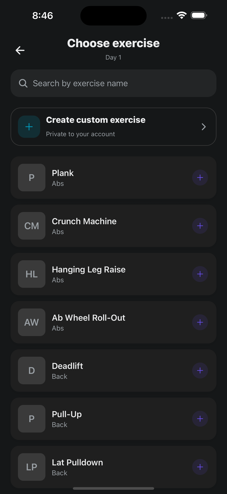
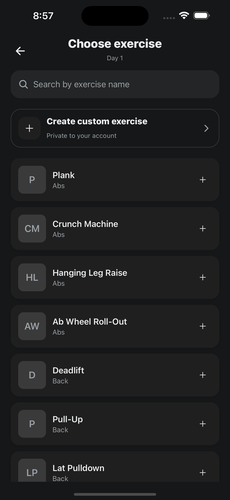
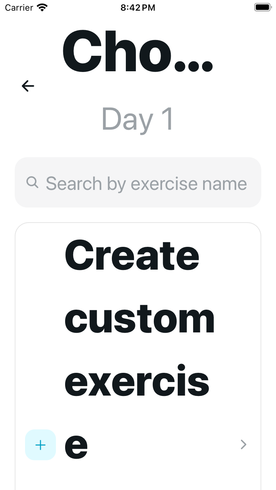
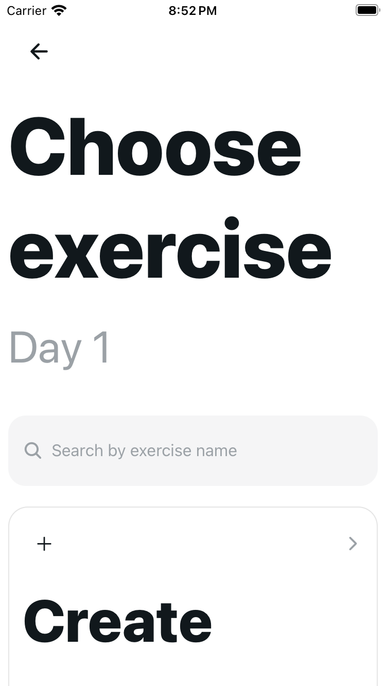
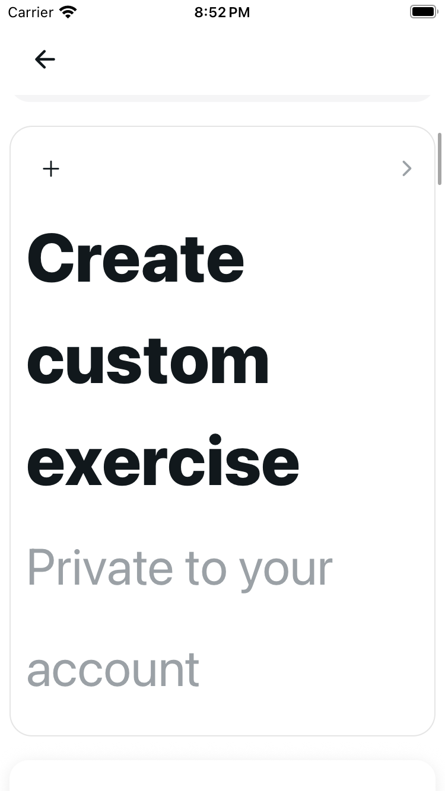
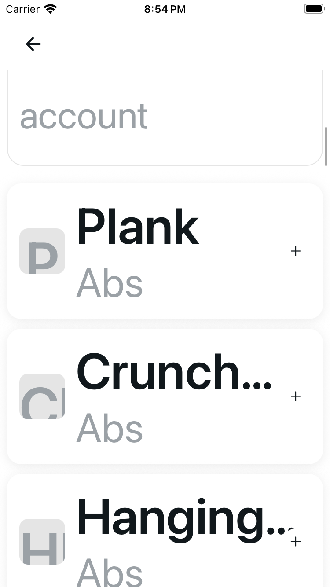

# Exercise picker: readable enlarged content and quiet secondary actions

Normal shared header/search/create layout is retained. Above fontScale 1.3, named 44-point Back stays fixed while one growing scroll body holds the uncapped 22-point heading, exact day subtitle, search, full-width custom-create copy and catalog/state content. Custom tile decoration sits separately from its text. Existing neutral theme colors replace cyan/purple secondary accents; meaningful selected green is unchanged. No copy, API/storage/dependency or text-scaling-cap change.

## Source and engineering

Base `9eca913d75ae4daaaa989f3857d64635816d3760`; source milestone `86b8dbae19cd9908f1adf3d1a641f7f14f685a41`. Exact source/shared/bundle pins and all image hashes, dimensions, methods and positions are in [provenance.json](provenance.json).

Author and independent engineering passed: 35 original cases retained with approved UI expectations → 49 focused / 1,301 full tests without skips; types, scoped/project lint (two existing unrelated warnings), UI audit/self-test and clear 62-HTML HTTPS export. Independent verification ran both full suites and checked twelve emitted modules; author emitted-source proof covers ten. These are local checks, not CI.

The original 929-byte controller is exact. Removing only the presentation useWindowDimensions import restores the original 968-byte prefix. Provider, paging hook, shared ProgramHeader/ScreenState/ExerciseRow, tracking helper, services and theme remain unchanged. Selection, reference-only reasons, debounce, pagination, account/request ownership and routes are preserved.

## Native method — three originals, five candidate configurations

iOS 18.5 / Expo SDK 54 existing custom client. Public builder inspection, without resetting, guarded empty inputs/default draft and zero days before creating one authorized unsaved Day 1 per setup; real catalog content was used without exercise selection or Save. No hidden draft injection.

There are exactly **three cold original images**. Candidate coverage uses **two guarded cold normal entries, then warm picker-only size/appearance transitions**—not five cold launches or five matched startup passes. Original SE is cold MAX with a visible Add exercise navigation retry; candidate SE is warm MAX after normal entry. Plus MAX is candidate-only.

| Configuration | Original | Candidate |
| --- | --- | --- |
| Plus Light normal (`large`) | [Cold settled](original-plus-light-large-picker-stable.png) | [Cold normal entry](candidate-plus-light-large-cold-picker-stable.png) |
| Plus Dark normal | [Cold settled](original-plus-dark-large-picker-stable.png) | [Warm appearance transition](candidate-plus-dark-large-warm-picker-stable.png) |
| SE Light MAX | [Cold initial, navigation retry](original-se-light-max-picker-initial.png) | Warm [initial](candidate-se-light-max-warm-picker-initial.png), [custom-copy scroll](candidate-se-light-max-warm-picker-custom-copy.png), [actual-row supplement](candidate-se-light-max-warm-picker-row-supplement.png) |
| Plus Light MAX | No matched original | Warm [initial](candidate-plus-light-max-warm-picker-initial.png), [actual-row supplement](candidate-plus-light-max-warm-picker-first-row.png) |
| Plus Dark MAX | No matched original | Warm [initial](candidate-plus-dark-max-warm-picker-initial.png), [actual-row supplement](candidate-plus-dark-max-warm-picker-first-row.png) |

Normal Dark — cold original, then warm candidate:

SE MAX — cold original initial, then warm candidate initial, custom-copy scroll and later actual-row supplement:

Original SE shows Cho… and Create/custom/exercis/e. Candidate initial shows whole Choose/exercise on two lines; later scroll positions show whole Create/custom/exercise and Private to your/account, then actual Plank/Abs. Back stays fixed and picker stays open. The custom-copy frame is not a row frame. Plus MAX row supplements show actual Plank/Abs and subtitle, but Create can clip at the top scroll boundary. No whole-CTA/state-in-one-frame, every-row/title/card or identical-gesture claim.

## Bounded actions and accessibility

On normal Light, public [Plank search](candidate-plus-light-large-search-plank.png) filtered the actual catalog to Plank without selecting it. Exactly one named [Clear exercise search](candidate-plus-light-large-search-cleared.png) restored an empty query and catalog rows; exactly one named [Back](candidate-plus-light-large-back-workout-day.png) returned to actual Workout day, Day 1, zero exercises.

Public native metadata verifies named Back/Search/custom/rows and enlarged heading role. iOS still exposes search/add glyph-only nodes; there is no decorative-glyph-removal or VoiceOver certification.

Software keyboard stayed hidden. Public Simulator menu attempts returned stale element IDs; no keyboard setting change was established. Keyboard-open, first tap with an open keyboard, dismissal and native keyboard avoidance are **unverified**. Handled/on-drag props are renderer/source evidence only.

## Limitations and exclusions

Original SE Add exercise initially remained on Workout day despite a logged tap; one freshly visible public retry reached the cold MAX picker. A coordinate scroll had no established effect; a later body-intended swipe opened the custom form. No entry/Save occurred; one approved public Back returned. Those failed/accidental frames are excluded. This does not establish an exact UIKit cause or that original rows were unreachable.

Shared-row longer-name ellipsis and avatar clipping at MAX remain. A repeated captured selection handler can deduplicate the exercise yet call Back twice in renderer tests; this separate inherited correctness observation is unchanged, not a proven native defect.

Native coverage is populated-picker presentation/search/Clear/Back only. Selected-green interaction, row selection, reference-only actions, guest/loading/error/Retry, paging and account races remain renderer-tested only. No program/custom-exercise Save, favorite/session/Health/permission/auth action, physical-device, Android or CI pass is claimed.

The canonical selection is fifteen unedited PNGs: three originals, nine candidate layout frames and three candidate action supplements. Exact raw hashes were verified. Setup/guard/private normal-SE, accidental-form, misleading first-row-named duplicate, transient/probe/debug/locked-capability frames and private credentials/logs/runtime inventories are excluded.

## Runtime handoff

Owned original and candidate Expo listeners stopped cleanly; temporary frontend port is free. Fictional sign-ins, isolated API and known unsaved Day 1/zero exercises remain retained. Plus ends Light/normal on Workout day after cleared search; SE remains Light/MAX on picker. Public logout remains approval-gated. No completed guest restoration, draft removal or fixture cleanup is claimed; protected usual services and real checkouts were not changed.
