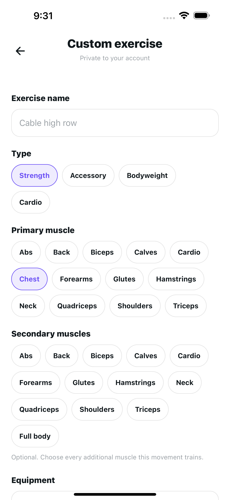
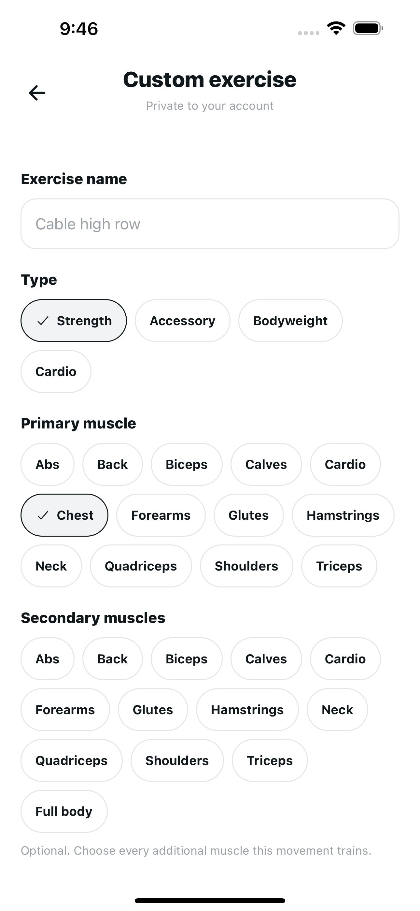
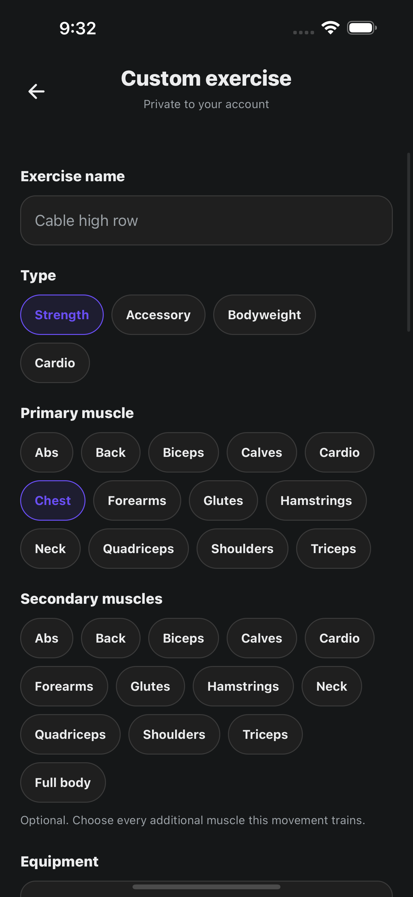
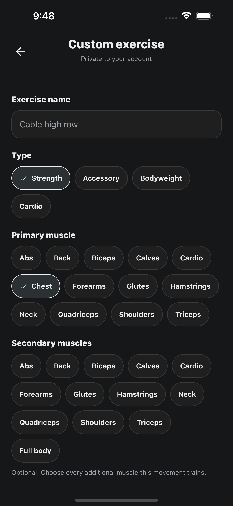
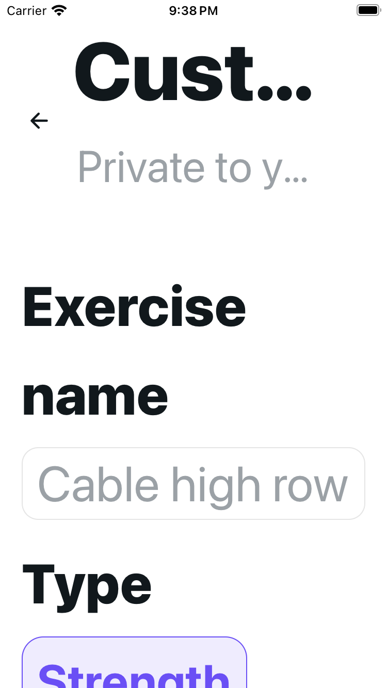
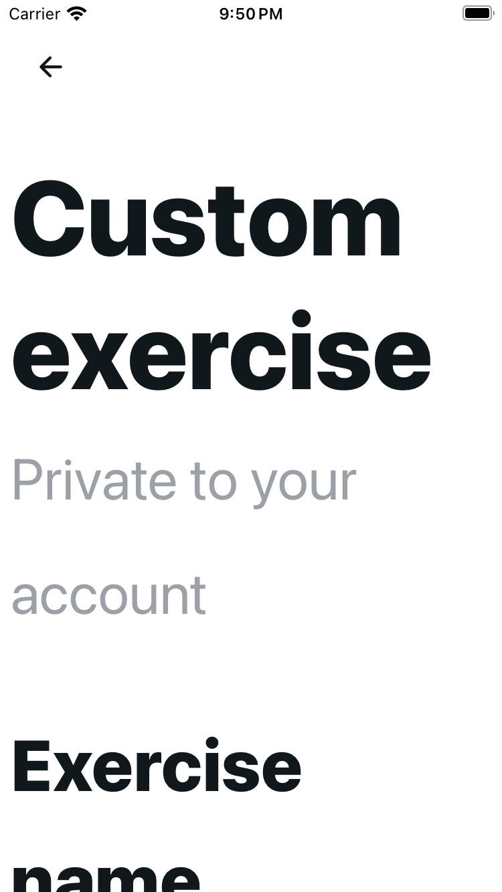
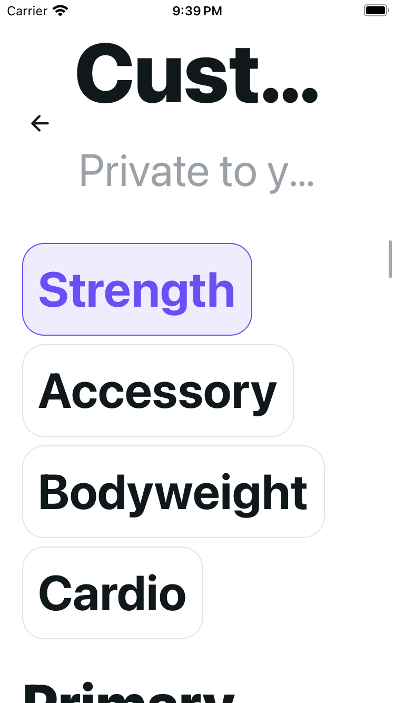
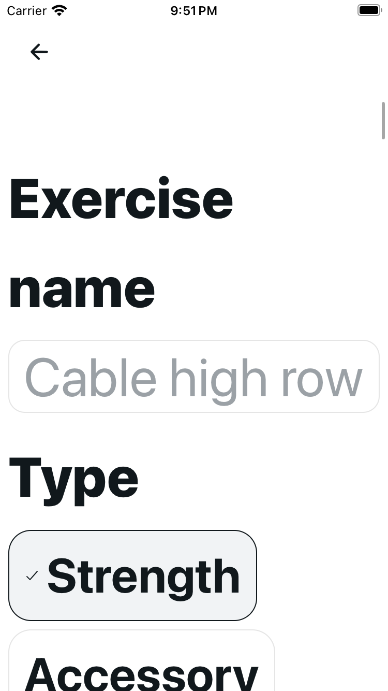
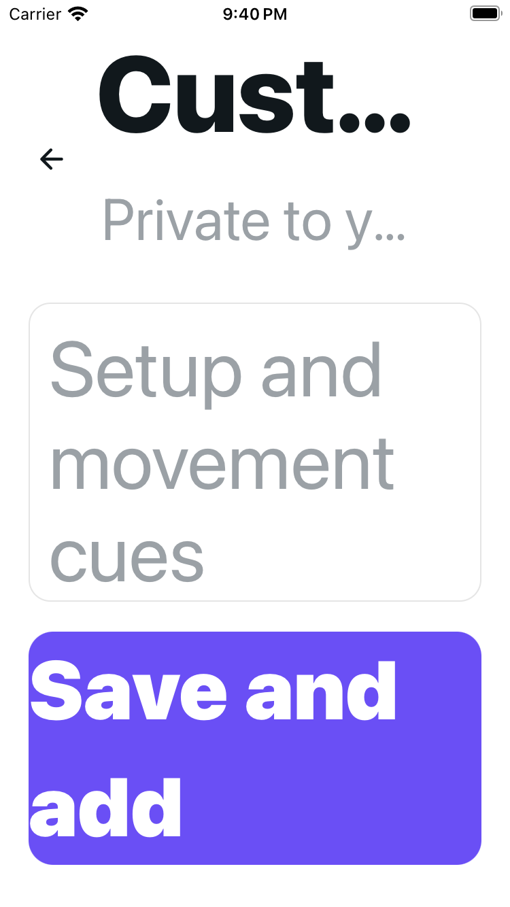
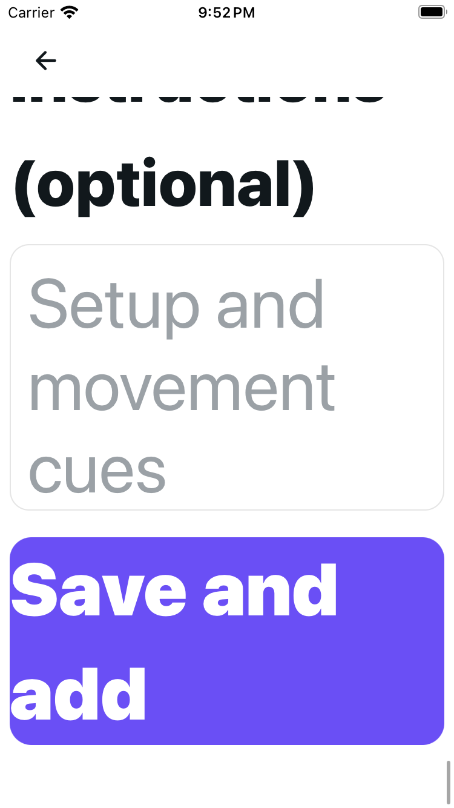

# Custom exercise: quiet selection and readable enlarged headings

Selected choices use neutral surfaces and explicit checks with 44-point minimum height. Bodyweight/equipment selection is neutral; Save remains purple. At `fontScale > 1.3`, the complete title and account-scope copy scroll with the form while a named 44×44 Back remains fixed. Normal text keeps the shared header.

Source milestone: `a6438949fce0c46620b78d1316822d5e5ef9e200`, based on `9eca913d75ae4daaaa989f3857d64635816d3760`. The original 6,550-byte controller, reconstructed 1,211-byte import prefix and shared modules remain exact. [Provenance](provenance.json) records source, bundle and all nineteen image pins.

## Before and after

| View | Original | Candidate |
| --- | --- | --- |
| Plus Light normal: purple selection becomes neutral with checks |  |  |
| Plus Dark normal: settled warm appearance |  |  |
| SE Light MAX: truncated fixed copy becomes complete scrolling copy |  |  |
| SE MAX Strength: candidate heading scrolls away while Back stays fixed; other candidate type choices are outside this frame |  |  |
| SE MAX Save: original screenshot endpoint follows a failed overshooting Bodyweight assertion; candidate explicit Save target succeeds |  |  |

Exactly one named Back returned from the empty candidate MAX form to the [actual picker](candidate-se-light-coldmax-back-picker.png). This supplement depicts the pre-PR #90 picker inherited from base `9eca913d`, intentionally unchanged here. Its MAX truncation is destination proof only, not a regression in current main after #90 merged.

## Native method and limits

iOS 18.5, existing Expo SDK 54 custom client. Nine original and nine candidate form images cover three configurations each: guarded cold Plus Light normal, warm Plus Dark appearance on the same untouched form, and cold SE Light MAX. Original Light needed isolated API recovery before canonical capture; original SE followed unsuccessful warm-size attempts and a public Add exercise navigation retry. Candidate SE needed a recovered driver guard without another cold launch or reset. These are three configurations, not three clean cold-start passes or identical-gesture comparisons.

Public guards established empty Build program and zero days before one authorized unsaved Day 1 per setup; normal routes forwarded the actual dayId. No synthetic draft injection or unknown draft reset. Save was visibly reachable in all three candidate configurations and was never pressed. Original SE bottom pixels establish Save reachability despite the failed Bodyweight assertion; neither side establishes MAX equipment/Bodyweight coverage. The candidate Save image has the Instructions heading partly above the viewport.

Native evidence covers the empty create form and one Back. No field input, type/muscle/equipment toggle, custom-exercise Save/update/archive or program persistence was performed. Edit/loading/error flows and interactions remain renderer evidence. Keyboard-open/dismissal, every row fitting, VoiceOver, physical devices, Android and CI remain unverified. Source inset/keyboard props and public accessibility semantics do not establish those behaviors.

Both owned Expo runtimes stopped cleanly; the isolated fixture API, fictional sign-ins and known unsaved Day 1/zero-exercise drafts remain retained. No logout or cleanup completion is claimed. The candidate runtime started at base `9eca913d`; source-only commit `a6438949` occurred during verification with identical route/harness bytes. Final metadata observed that commit; no separate post-commit runtime restart or bundle capture is claimed.

## Engineering

Original baseline: 69 accepted cases. Final author/independent gates pass 91 focused and 1,343 full cases; focused cases are included in full. Independent full verification repeats twice. Current-main `00201d38` composition with merged PR #90 passes 1,392 twice and preserves its nineteen-file packet without overlap. Types, scoped lint, UI audits/self-tests and 62-page web export pass; normal Expo lint retains two inherited warnings. Twelve independently checked emitted modules match their source contracts. No CI pass is claimed.

Inherited correctness observations remain separate: an earlier Save can complete after a same-mounted mocked route change; unsupported/duplicate taxonomy values arise from adversarial mocked service responses. Neither is an observed native defect or evidence about real server records. Unmount tests establish no late navigation or captured save warnings, not every avoided setter or transport abort. No behavior fix is included.

All nineteen canonical images

| Configuration | Original | Candidate |
| --- | --- | --- |
| Plus Light normal top | [Top](original-plus-light-normal-form-top.png) | [Top](candidate-plus-light-normal-form-top.png) |
| Plus Light normal equipment | [Equipment](original-plus-light-normal-equipment.png) | [Equipment](candidate-plus-light-normal-equipment.png) |
| Plus Light normal Save | [Save endpoint](original-plus-light-normal-save-reachability.png) | [Save endpoint](candidate-plus-light-normal-save-reachability.png) |
| Plus Dark normal top | [Settled actual top](original-plus-dark-normal-true-top.png) | [Settled actual top](candidate-plus-dark-normal-form-top.png) |
| Plus Dark normal equipment | [Equipment](original-plus-dark-normal-equipment.png) | [Equipment](candidate-plus-dark-normal-equipment.png) |
| Plus Dark normal Save | [Settled Save endpoint](original-plus-dark-normal-settled-save-reachability.png) | [Settled Save endpoint](candidate-plus-dark-normal-save-reachability.png) |
| SE Light cold MAX title | [Truncated fixed title](original-se-light-coldmax-form-top.png) | [Full scrolling title](candidate-se-light-coldmax-title.png) |
| SE Light cold MAX Strength | [Type choices](original-se-light-coldmax-strength.png) | [Strength and empty name](candidate-se-light-coldmax-strength.png) |
| SE Light cold MAX Save | [Failed target, actual Save endpoint](original-se-light-coldmax-scroll-limit.png) | [Successful Save target](candidate-se-light-coldmax-save-reachability.png) |
| SE MAX Back supplement | — | [Actual pre-PR #90 picker destination](candidate-se-light-coldmax-back-picker.png) |

Only canonical PNGs are included. Excluded material comprises OfflineScreen/stale hierarchy outputs, immediate appearance frames still Light, partial Dark top positions, unsuccessful warm MAX/setup images, builder/day/picker guards, failed-driver/debug outputs and prior runtime frames. No excluded image is counted as a form pass.
