# U35 · Edit Profile

Change photo and Cancel use neutral text. The local photo action row fills the available width, wraps, and centers bounded labels. Save stays purple; destructive Remove, avatar initials and meaningful unit/gender selection colors remain unchanged. Shared profile UI, controller and data behavior are unchanged.

These are 16 unmodified canonical screenshots: eight original and eight candidate across three configurations. Exact dimensions, byte counts, SHA-256 hashes, accepted captions, source/bundle provenance and exclusions are in [provenance.json](provenance.json).

## Plus · Light · normal text

Cold authenticated entry into the untouched fictional form. Top shows Change photo; bottom shows Cancel, full private copy and unchanged body values. Save is disabled.

| Original | Candidate |
| --- | --- |
| 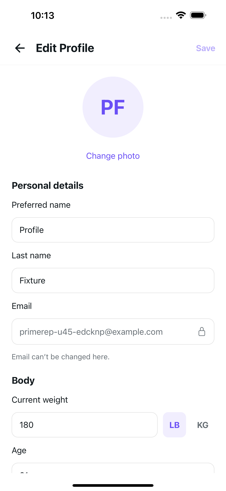 | 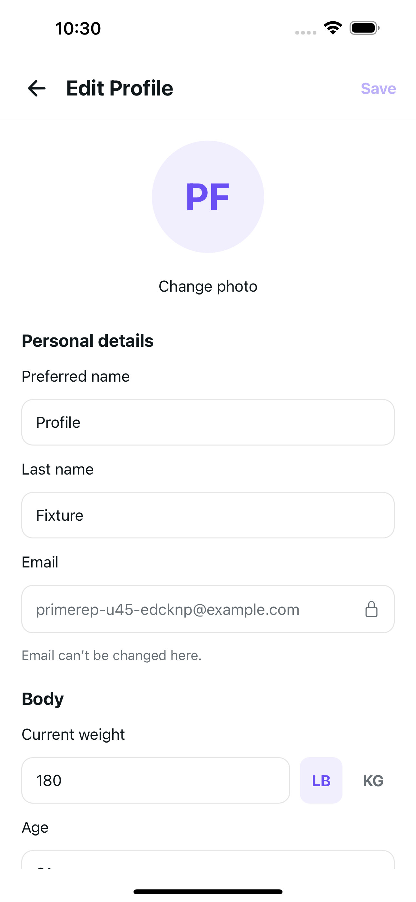 |
| 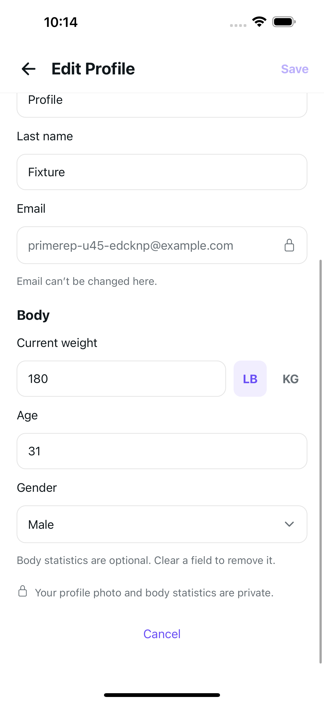 | 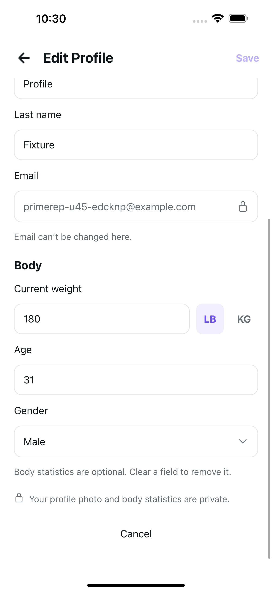 |

## Plus · Dark · normal text

Settled warm appearance transitions on the same untouched form, not additional cold starts. Actual top and scroll-to-Cancel bottom were inspected. Change photo and Cancel become neutral; selected LB and disabled Save retain purple.

| Original | Candidate |
| --- | --- |
| 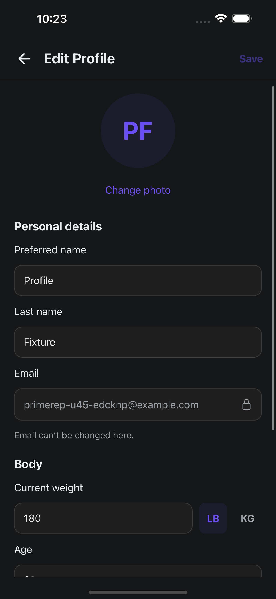 | 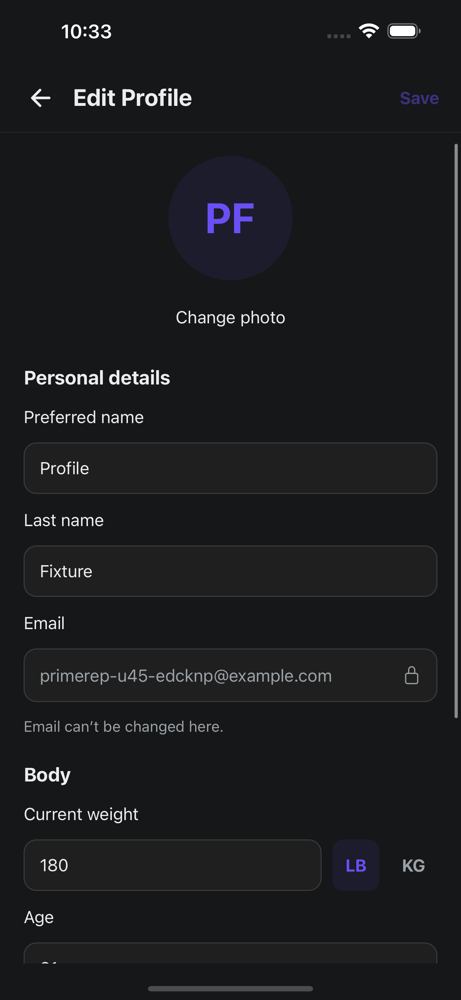 |
| 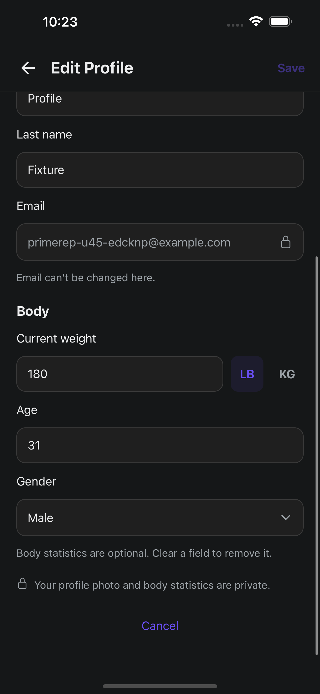 | 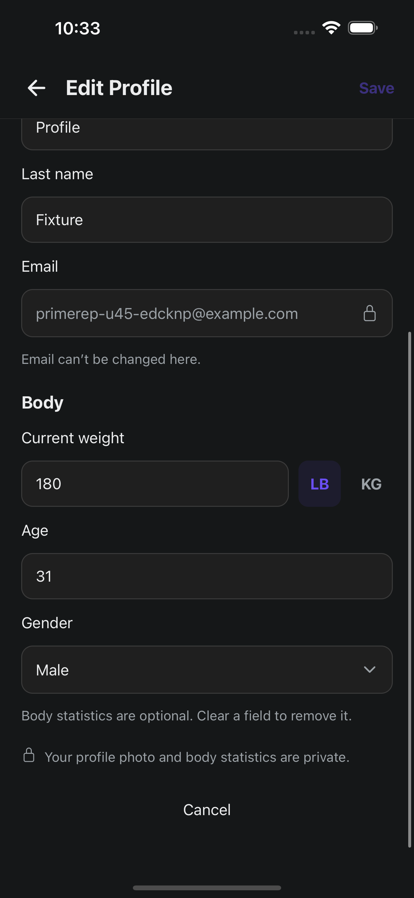 |

## SE · Light · cold MAX accessibility text

Photo: Change/photo is readable as whole words and centered in the candidate. Existing shared Edit/Pro/file word breaks and clipped PF initials remain. Initial photo action bounds extend 6pt below the viewport; this is not whole-hit-target-fit certification.

| Original | Candidate |
| --- | --- |
| 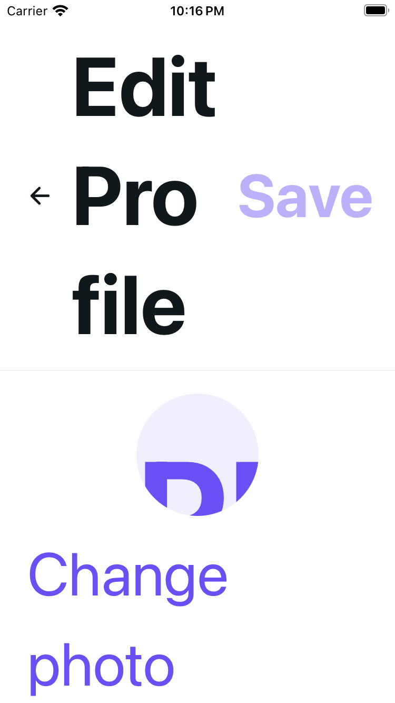 | 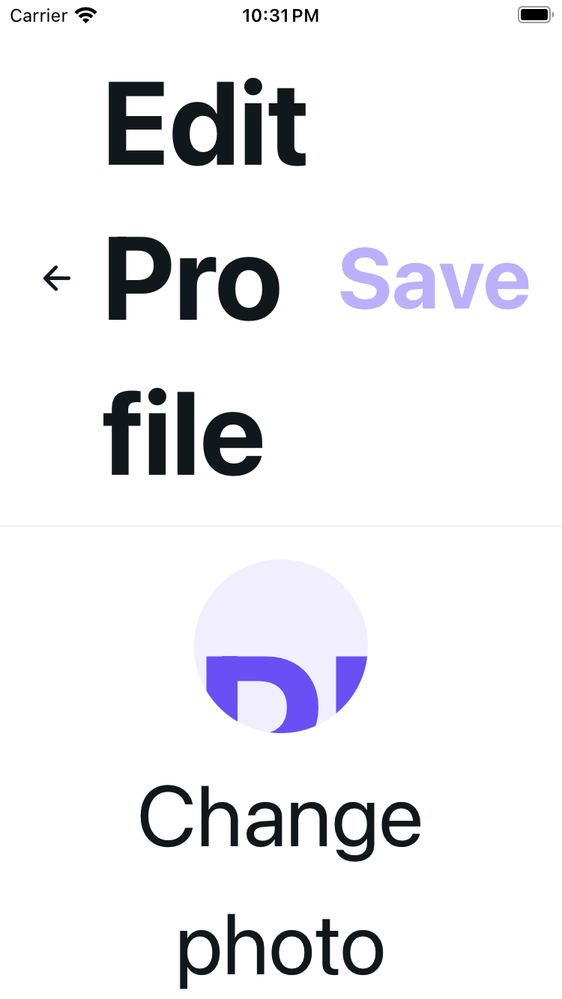 |

Weight: bounded body-gutter scrolling reaches the complete unchanged 180 input and LB/KG controls; LB remains selected. The original default scroll-to-weight assertion failed before this adapted scrolling. Candidate positions use the established gutter method; gesture groups are not claimed identical.

| Original | Candidate |
| --- | --- |
| 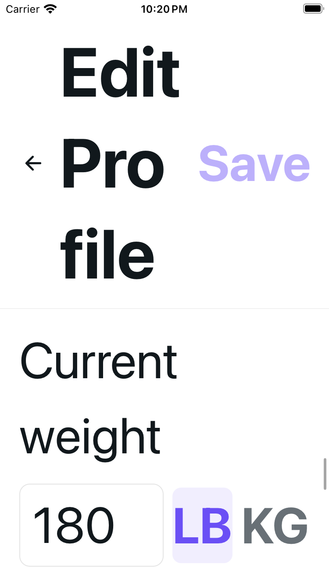 |  |

Gender: age 31, Gender/Male and the closed chevron are visible. Lower gender-control bounds extend below the viewport; no whole-control-fit or opened-gender claim.

| Original | Candidate |
| --- | --- |
|  | 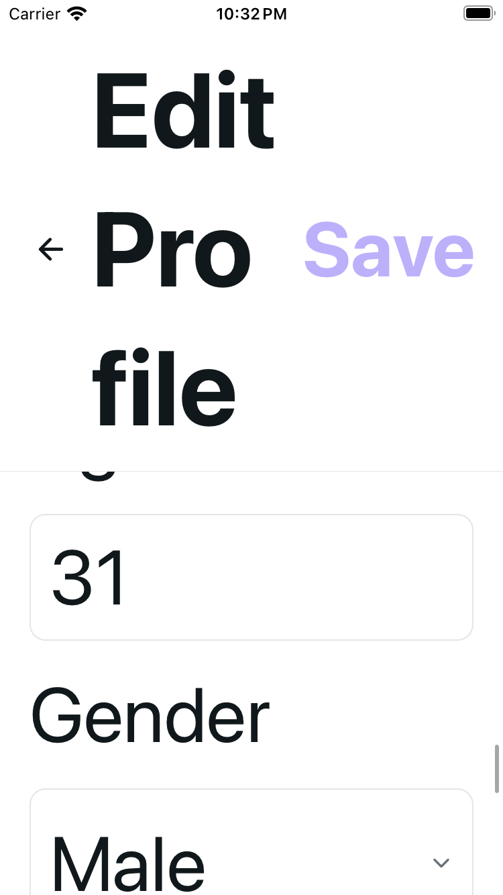 |

Cancel endpoint: complete Cancel and lower private-copy words are visible. Upper copy is above the viewport, so MAX copy is not all visible in one frame. Cancel was not pressed.

| Original | Candidate |
| --- | --- |
| 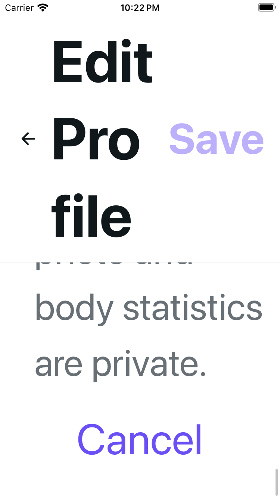 | 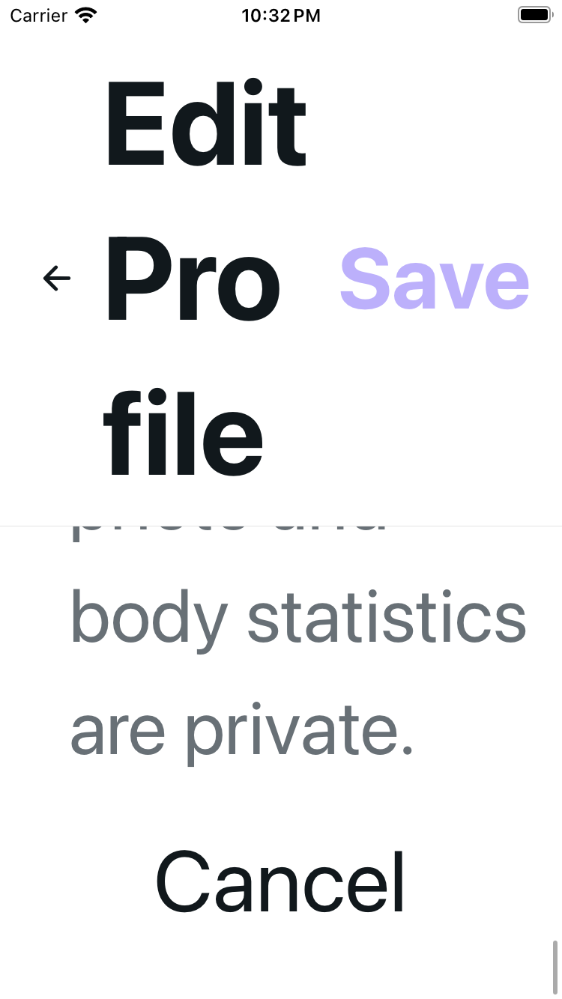 |

## Method and qualifications

Original setup first showed offline while the isolated fixture API was unavailable. After restoration, one observed Retry still failed its bounded wait; one authorized cold bootstrap then loaded the actual form. Setup/error, prior-screen and intermediate images are excluded. This is not a clean first-startup certification. Candidate form entry succeeded in two cold configurations; Dark normal is a warm appearance transition.

Source base is `00201d38`; the source milestone is `aced509c`. Candidate capture began on the base and continued across that metadata-only milestone with identical frozen route/test bytes. No distinct post-commit bundle restart is claimed. Separate local composition on merged main `f3ca6dcb` verified U35 with PR #91; captured native source was not rebased.

## Verification

- 85 focused tests; author named discovery: 1,385 tests in 52 files, excluding the audit wrapper; default discovery: 1,386.
- Independent QA: 85 focused, 18 foundational and two full 1,386-test runs. Actual-main composition: two 1,477-test runs with merged PR #91 files preserved.
- UI-action audit/self-tests, syntax, scoped lint and diff checks pass. Project lint has zero errors and two inherited hook warnings.
- HTTPS-placeholder export: 62 HTML routes; emitted route matches the frozen source. Independent export verified 14 exact source modules, including the existing web private-file implementation.
- Type checking was **skipped** because U35 imports/types are unchanged, as repository instructions require.

Renderer tests cover the actual route/provider with explicit mocks, including both-theme with-avatar Remove and pending-picker geometry/states. They prove structure and contracts, not native photo integration or two-action fit.

## Boundaries and follow-up

All native captures show untouched, disabled Save and a placeholder avatar without Remove. No native field, unit, gender, photo, Save, Cancel or Back activation, dirty/pending Save, removal, discard, persistence, keyboard-open/dismissal, VoiceOver, physical-device, Android or CI acceptance is claimed.

The shared MAX header height/word breaks and PF avatar clipping remain unchanged. A separate shared ProfilePage/ProfileAvatar accessibility follow-up should address them across consumers; this PR does not certify every element fits. Existing picker/Cancel availability, delayed-unit error/Retry and mocked account/provider-ordering observations are retained.

No dependency, configuration, migration, provider, service, shared component or rollout flag changes.
