# Variety large-text layout — native evidence

Six matched cold initial configurations and three scrolled MAX footer supplements were accepted on iOS 18.5 simulators using the installed SDK54 binary. All 15 PNGs are unedited, byte-exact raw copies; [provenance.json](provenance.json) records their hashes, dimensions, captions, and frozen source pins.

## Initial viewports

Each pair uses the same fixture, theme, text size, and existing selection: Plus saved Varied; SE unset. MAX means `accessibility-extra-extra-extra-large`. Content can continue below the initial viewport, including the SE/MAX question.

| Configuration | Original initial | Candidate initial |
| --- | --- | --- |
| Plus Light / large | 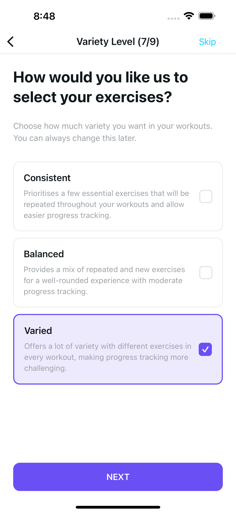 | 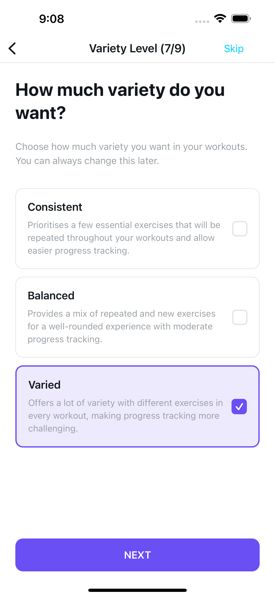 |
| Plus Dark / large | 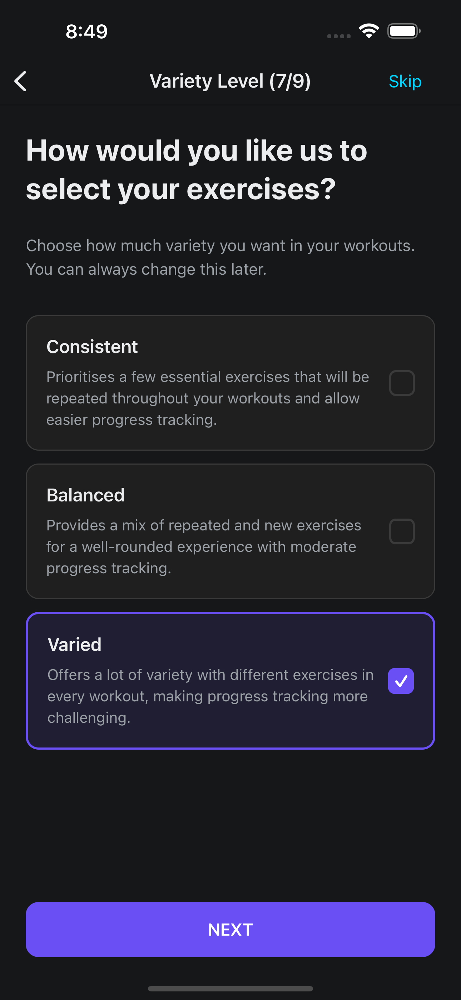 | 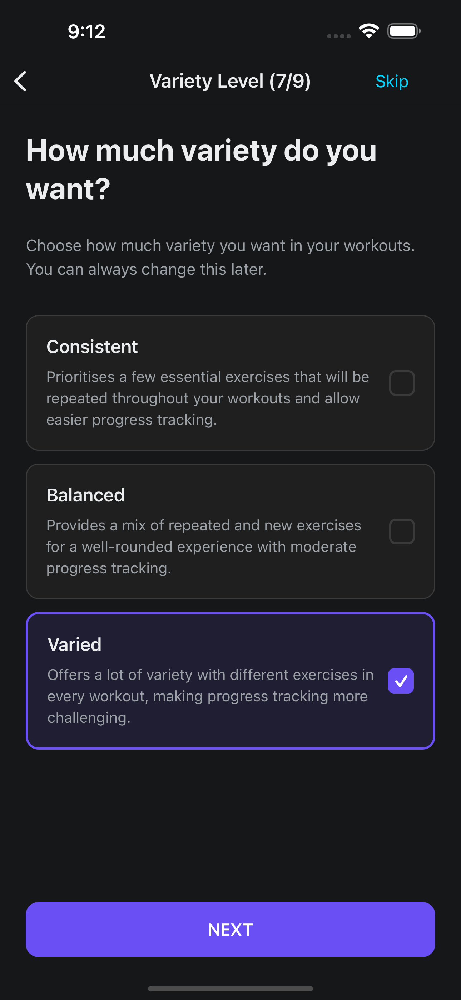 |
| Plus Light / MAX | 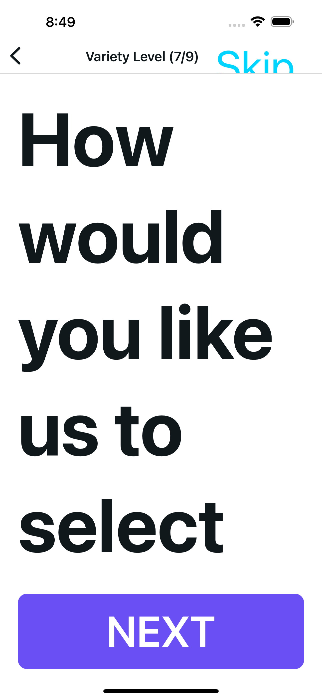 | 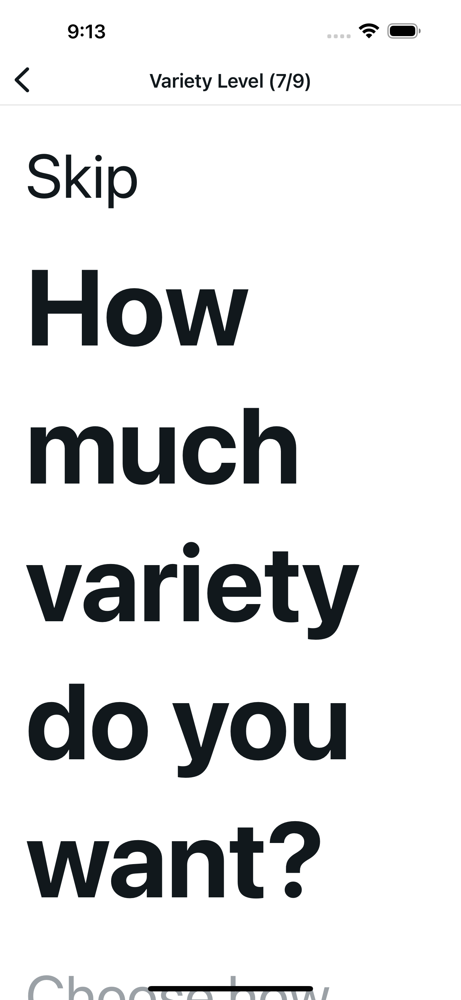 |
| Plus Dark / MAX | 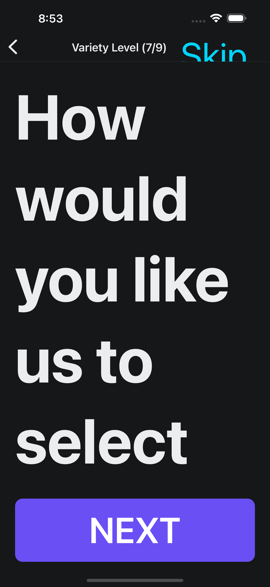 | 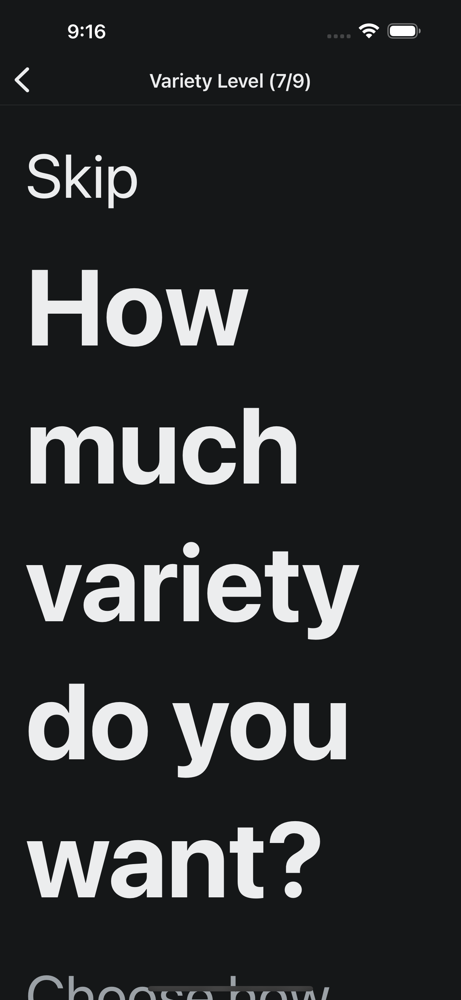 |
| SE Light / large | 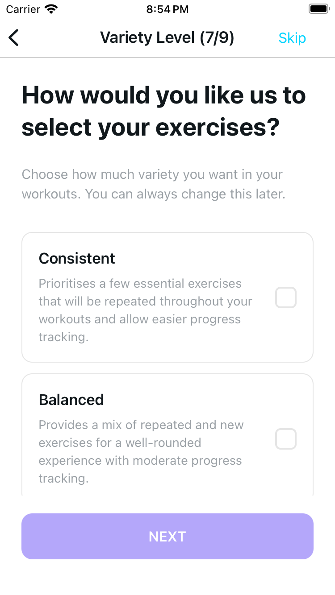 | 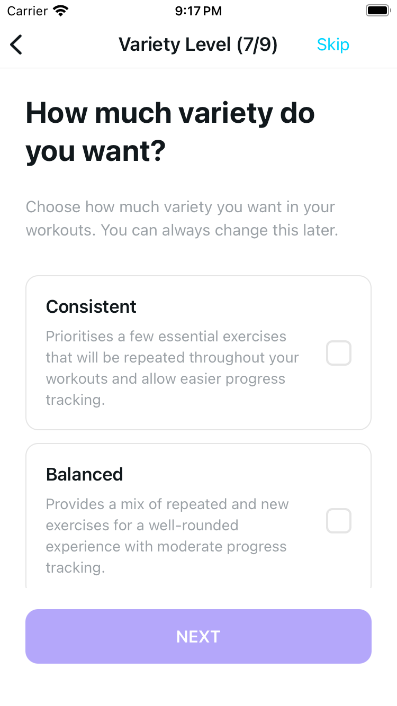 |
| SE Light / MAX | 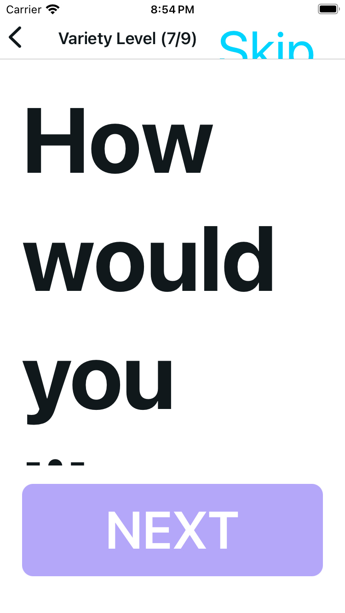 | 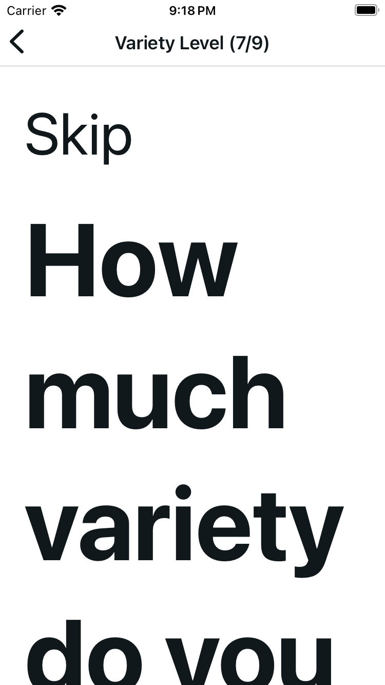 |

## Scrolled footer supplements

These are three additional frames of existing configurations, not new configurations or initial viewports. Each shows the lower Varied description and full Next control; the card title is above the viewport. No whole-card or whole-form MAX viewport fit is claimed. Next remains enabled on Plus and disabled on SE.

| Plus Light / MAX | Plus Dark / MAX | SE Light / MAX |
| --- | --- | --- |
| 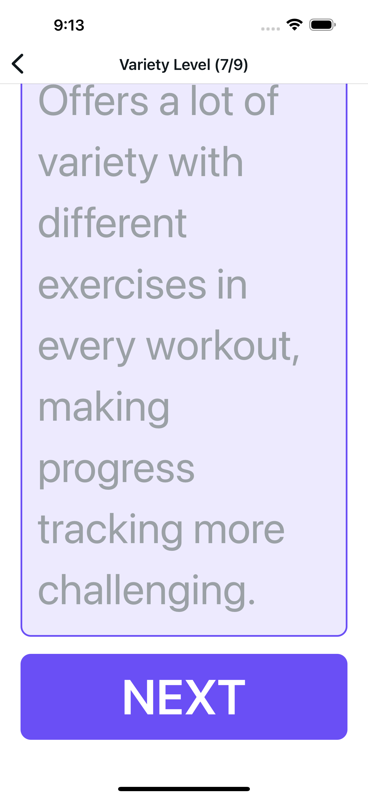 | 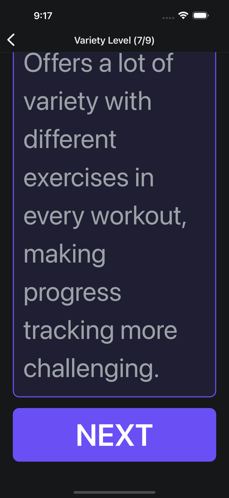 | 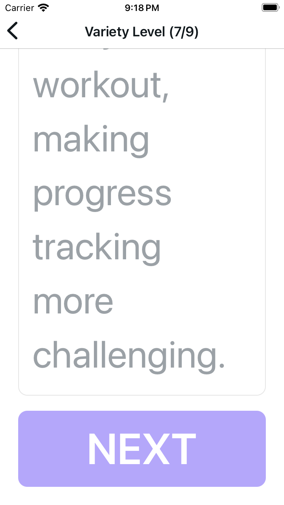 |

MAX Skip and Next are in the scroll flow, with no clipped header Skip or pinned footer consuming the viewport. Bounded public scroll gestures reached partial first-card content and the full footer. Spot measurements: normal Plus header Skip 44pt; normal Next 52pt, matching original; Plus/MAX local Skip 85pt; Light/MAX Next 101pt above the home area. User text remains scaled.

## Behavior and provenance

The baseline is merged main `78c6d0cd1f7a3e182fb19b75b0a8e1e9205286b2`, including #83. Its existing Plus Varied and SE unset states were preserved for these original/candidate captures; no storage clear or injection manufactured the comparison.

Normal trees expose all three unchanged complete title/description radio names without `✓`. Native encoded radio `value` establishes checked state; generic driver flags do not. After the six initial captures, exactly two Plus Dark/MAX taps selected Balanced then Varied. The tapped target was checked and other visible radios were unchecked; hidden offscreen nodes are not certified. One cold restart retained Varied. One enlarged Skip tap reached unchanged Final, and one public Back returned to the named Variety scroll. Plus finished with its original Varied; SE was never selected. No Next or account action was tapped: Training Place routing is harness-verified only. Preference taps intentionally persisted the guest draft.

The original failed 50% third-card visibility check remains a private diagnostic, not a passing assertion or canonical frame. Stale-source and YAML direction-parse diagnostics are excluded, as are private content, selection, persistence, Skip/Back frames and inventories.

Frozen feature hashes and unchanged Provider are in [provenance.json](provenance.json). The original 3,756-byte controller remains exact after removing only the three added presentation-hook lines: SHA256 `708988e89643d136b2443c5cbbd394b3e602f5022da2c19f90788f422b479526`. The sole copy change is the question. APIs, storage behavior, dependencies, theme tokens, shared layout, option copy, handlers, and animation configurations are preserved.

## Engineering and flow

Variety 27/27 plus six prior consumers 196/196 pass; full suite 1,011/1,011. Independent verification retained actual suite and emitted-module evidence. Type checking, scoped lint, interaction audit/self-test, and diff checks pass. Normal lint passes with two existing hook warnings. A fresh dotenv-disabled HTTPS web export produced 62 HTML routes; source-map content matches the frozen feature files and unchanged Provider.

[The packaged flow](../../../.maestro/variety-large-text-refinement.yaml) is byte-identical to the native owner's recorded initial/content/footer flow. Use explicit `MODE=initial|content|footer` and an absolute `SCREENSHOT_PREFIX` with the authorized fixture/runtime. OS settings, cold connections, inventories, selection/persistence, and Skip/Back were separate recorded checks; this YAML alone does not reproduce the full matrix or behavior verification. Maestro guidance informed this scope.

No physical-device, VoiceOver/audio, CI, or broader navigation verification is claimed. No backend was started. Recorded STOP: owner session 58564 / PID 33032 exited 0, its PID was absent, and 8083 was free. Protected 8081 / PID 77763, 8000 / PID 77326, and 8082 / PID 22150 were unchanged; 8001 remained closed. The fictional fixtures were handed off to separately authorized Final verification. Final usual-8081 restoration is deferred until that slice ends; no completed final-restoration claim is made here.
