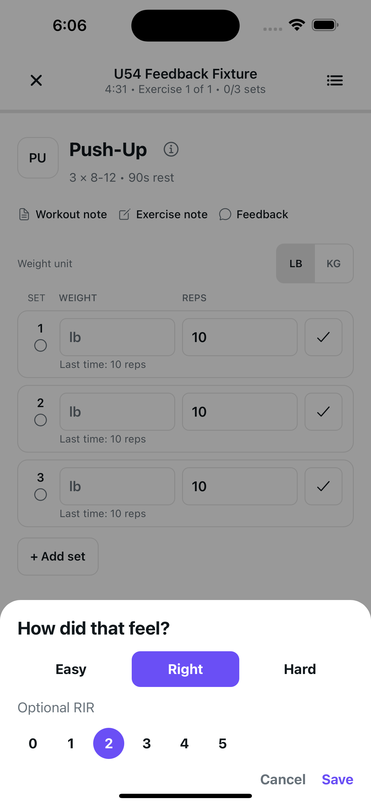
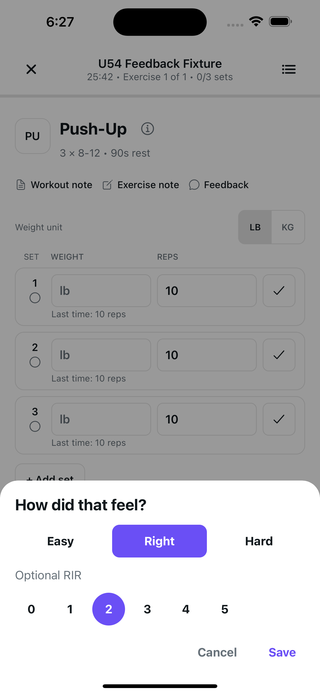
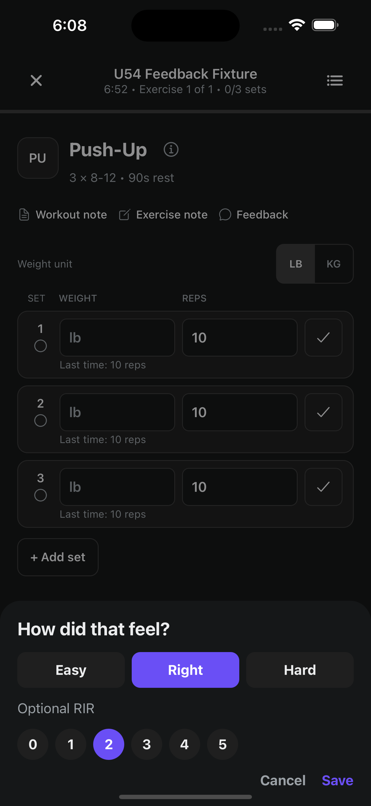
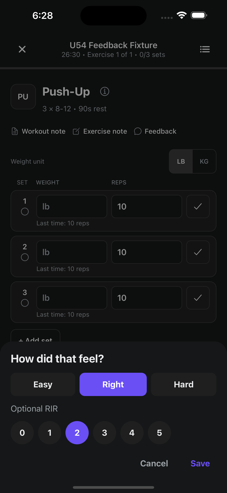
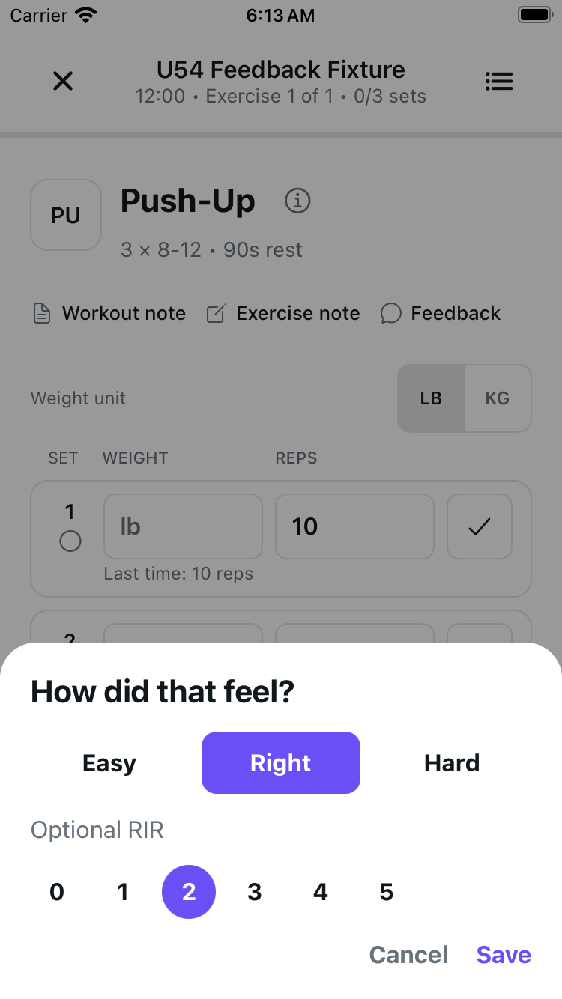
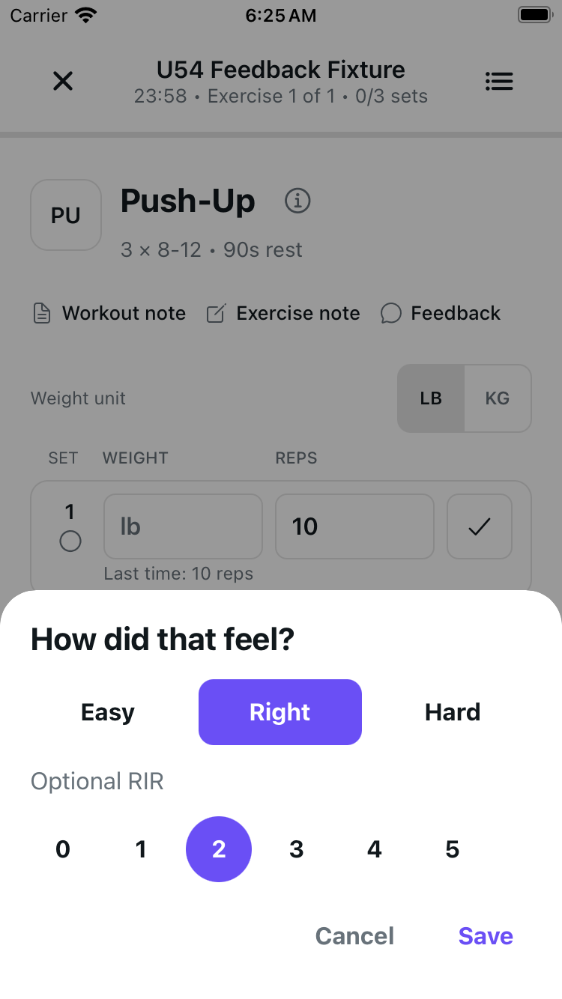
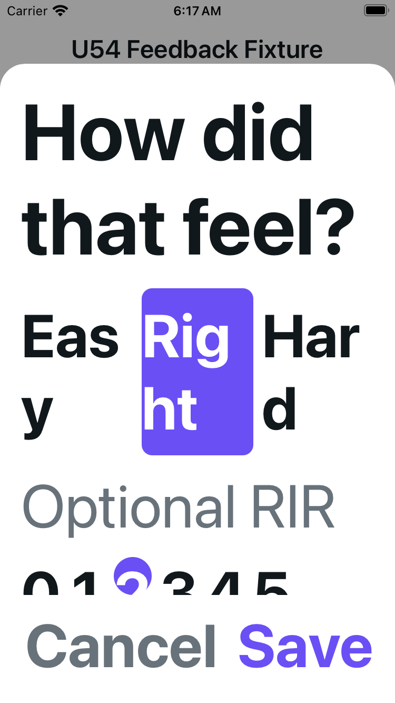
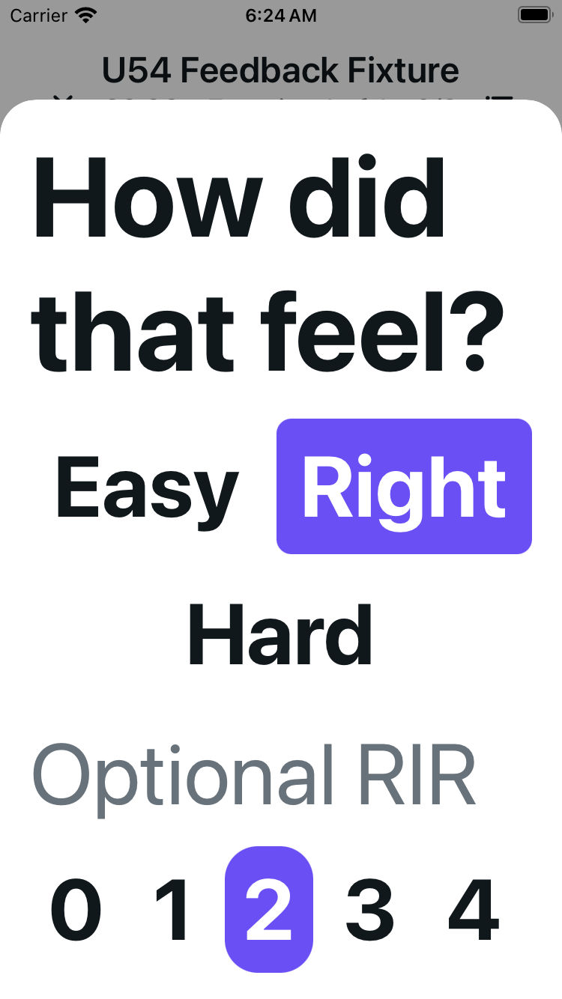
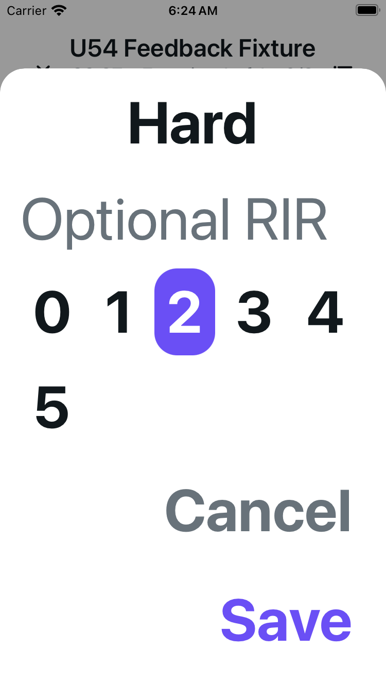

# Workout feedback accessibility

Feedback keeps its effort/RIR colors and Save behavior, with larger targets,
explicit names and selected states. A content-height scroller keeps wrapping
choices and actions reachable without capping text. All logger code outside
the feedback modal is unchanged; RIR remains optional, including zero.

Nine unedited simulator PNGs cover four configurations on iOS 18.5. Normal means
the OS Large category; MAX means Accessibility Extra Extra Extra Large. Exact
source/image hashes and methods: [provenance.json](provenance.json).

## Plus · Light · normal

| Before | After |
| --- | --- |
|  |  |

## Plus · Dark · normal

| Before | After |
| --- | --- |
|  |  |

## Compact SE · Light · normal

| Before | After |
| --- | --- |
|  |  |

Observed normal bounds: all six RIR controls 44×44 points, effort 44 points high,
Cancel 77×44 and Save 62×44. These are measured native frames, not dimensions
inferred solely from renderer styles.

## Compact SE · Light · MAX

| Before | After top |
| --- | --- |
|  |  |

One body drag reaches the actual endpoint. Words and 0–5 are readable across
the two frames; Save/Cancel fit fully inside the compact viewport. The original
View-only sheet had no scroller or separate endpoint: no matched-before bottom
is invented. Right/RIR2 are temporary selections; Save was never pressed.

The unchanged MAX logger footer overlap still required body scrolling to reach
Feedback in both phases. That host-entry/header/column work remains U54b, not
fixed or certified by this sheet change.

## Verification and limits

Author and independent local checks each passed 21 focused contracts within one
1,779-test standard run, audits and a 62-page web export (18 selected exact-source
modules for the author, 15 independently). Lint: zero errors, two inherited
warnings. Typecheck skipped: production imports/types unchanged; not a typecheck
or CI pass.

Native checks used an isolated fictional active-workout fixture; temporary choices
were cancelled, with no feedback Save, set logging, finish or Health action.
The full-route renderer uses in-memory boundaries and checkpoints its initial
autosave; it does not certify transport/SQLite/account races. No VoiceOver,
keyboard-in-sheet, physical-device or full matrix claim. Source was committed
after capture; file hashes prove equivalence, not a post-commit runtime restart.
