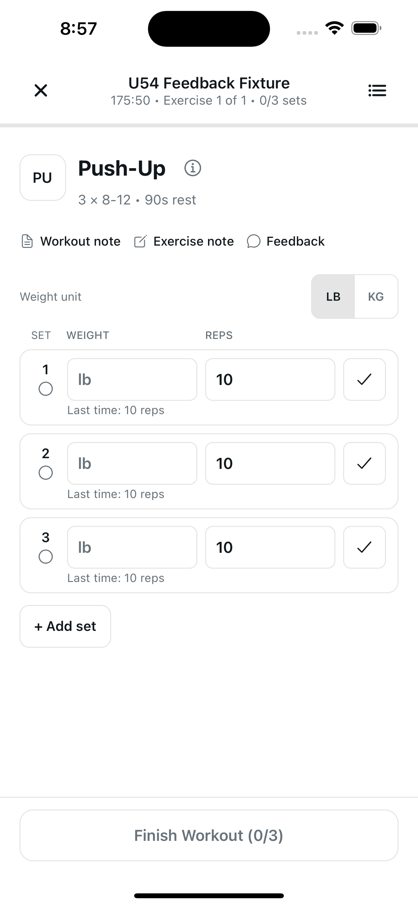
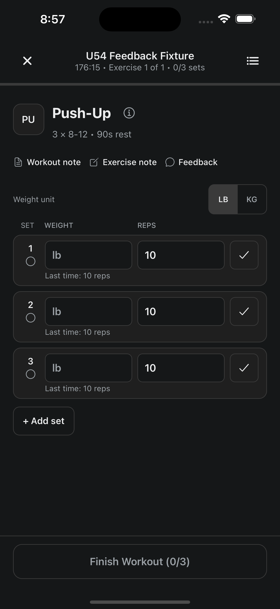
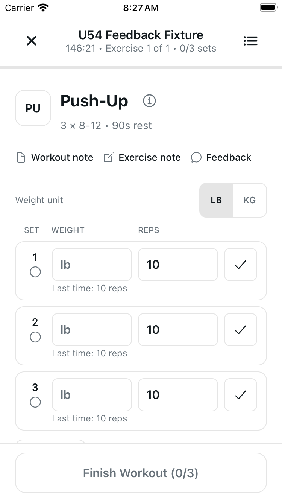
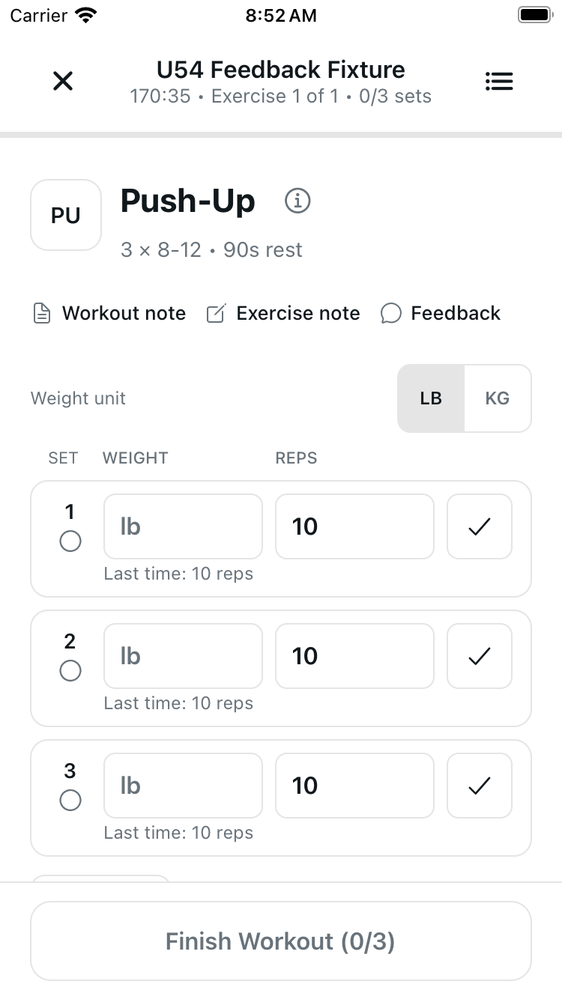
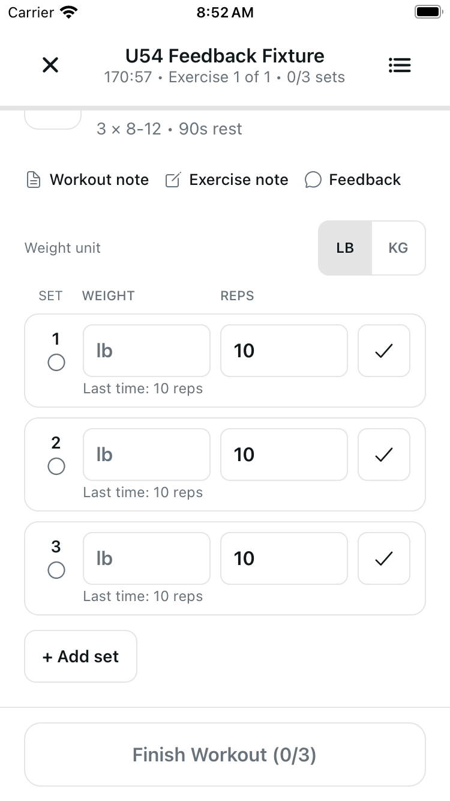
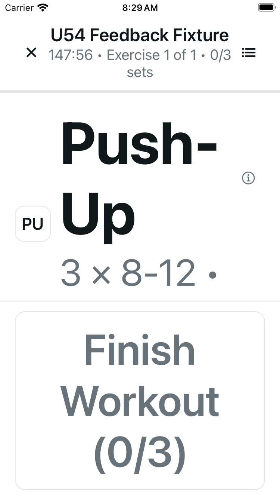
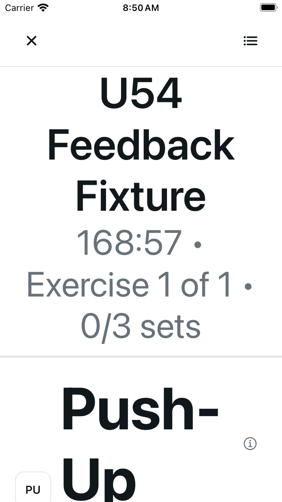
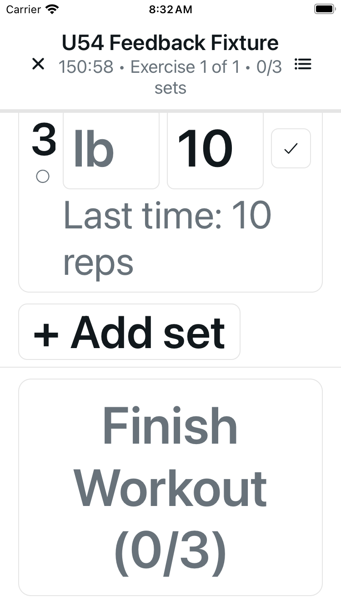
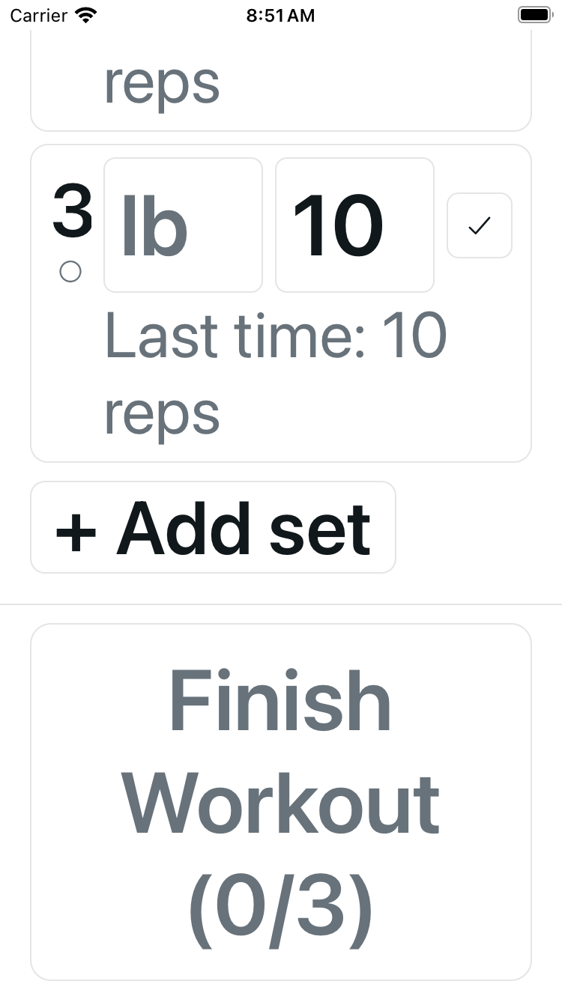
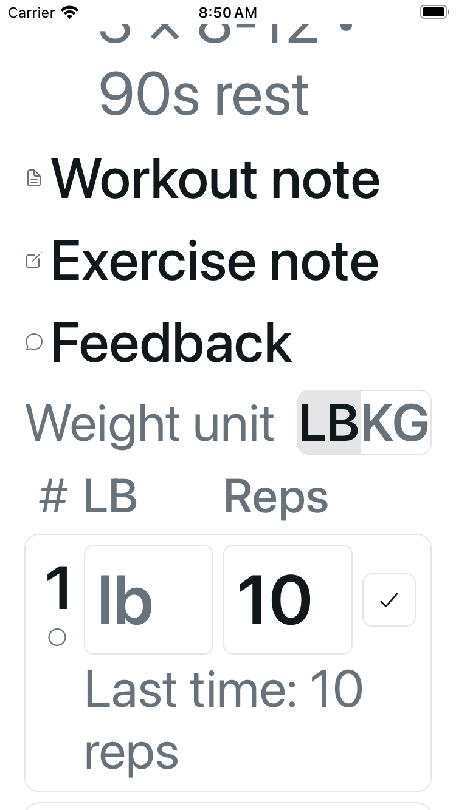

# Workout logger: readable expanded controls

Normal text retains fixed Close, exercise list, progress and Finish controls.
At larger text sizes, the full uncapped title and Finish section join the existing
scroller. Compact unit headings retain “each”/“Total” meaning with full accessible
labels; the column grid, palette, inputs, feedback sheet and workout logic stay unchanged.

## Normal layouts

| Configuration / position | Before | After |
| --- | --- | --- |
| Plus, Light, normal — initial |  |  |
| Plus, Dark, normal — initial |  |  |
| SE, Light, normal — initial |  |  |
| SE, Light, normal — endpoint |  |  |

Normal geometry is preserved. On SE, Add set remains partly behind the fixed
footer initially; scrolling reaches it at 100%, before and after.

## SE, maximum accessibility text

The original fixed chrome left a 279-point body. The expanded logger uses one
647-point scroll viewport. These are different positions, not simultaneous fit:
the original bounded bottom reached 99%, while the candidate reached 100% and
returned to the top. Elapsed time is naturally dynamic.

| Position | Before | After |
| --- | --- | --- |
| Initial title/header |  |  |
| Bounded bottom / final endpoint |  |  |

After-only mid-scroll frame (47%): aligned `#` / `LB` / `Reps`, first row and full
Last time hint. There is no invented matching original legend frame.

## Verification and limits

- Local author and independent checks: 31 focused contracts included within
  1,789 standard tests, actual typecheck, audits and scoped lint pass. Project
  lint has two inherited warnings. Web export: 62 pages; author verifies 18
  exact emitted-source matches. These are local checks, not CI certification.
- Four cold simulator configurations per side; six before and seven after raw
  PNGs, all fresh. Only final accepted candidate captures are published.
- Same isolated fictional workout remained at 0/3. A blank-weight focus followed
  by a tap in an actual body gap dismissed the keyboard without typing. An outer
  padding-gutter tap did not dismiss it; that observed edge remains a separate
  follow-up, without an established new cause or blanket gesture claim.
- No native Save, finish, durable transport, VoiceOver, physical-device or Android
  certification. Other unit/equipment combinations and the short-height branch
  are renderer-tested, not native-fit claims. No all-content-in-one-frame claim.

Images are unedited canonical PNG bytes. Captures preceded the source commit;
file hashes establish equivalence, not a post-commit runtime restart.
See [provenance](provenance.json) for exact image/source hashes and methods.
