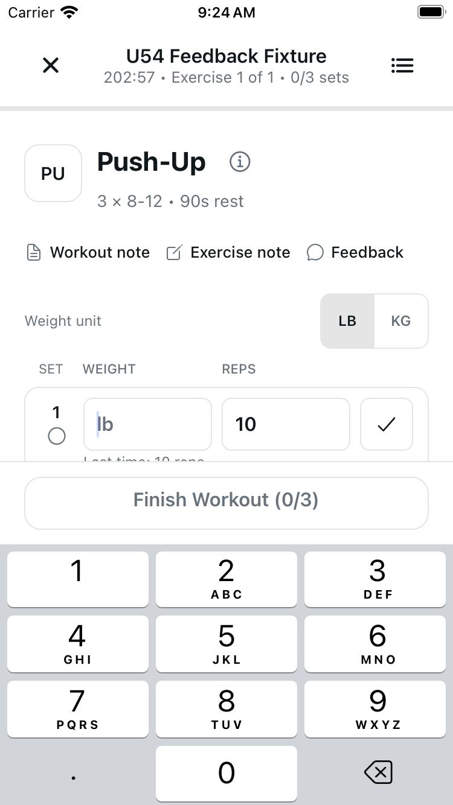
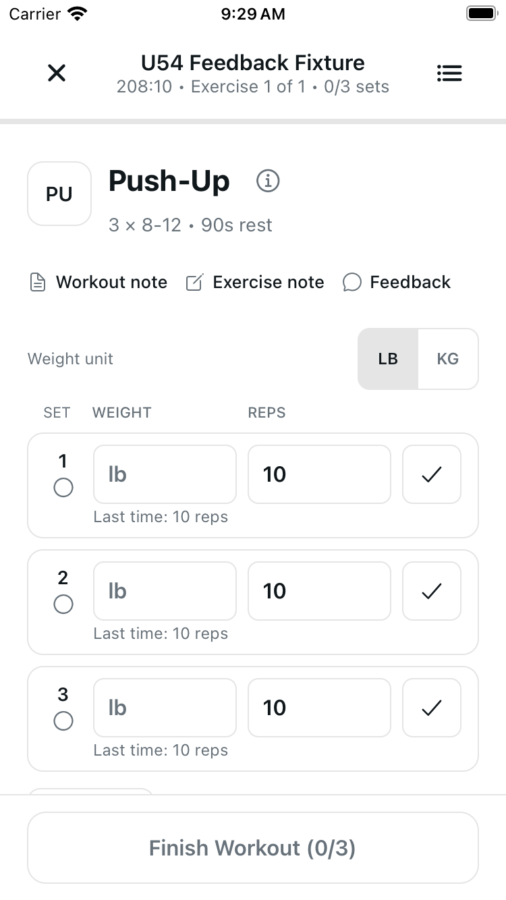
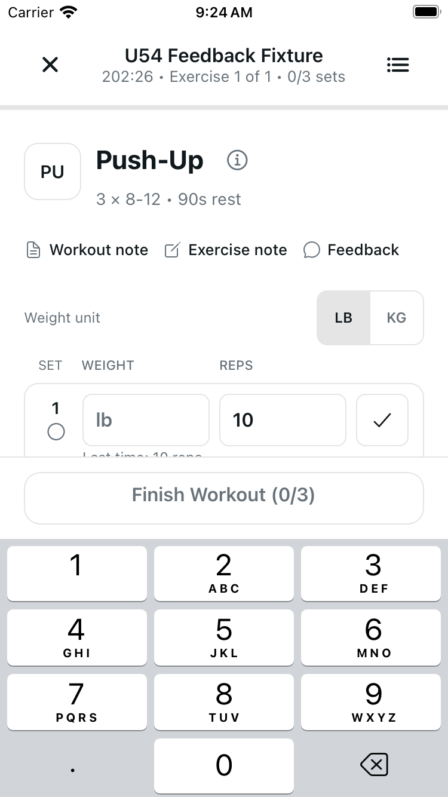
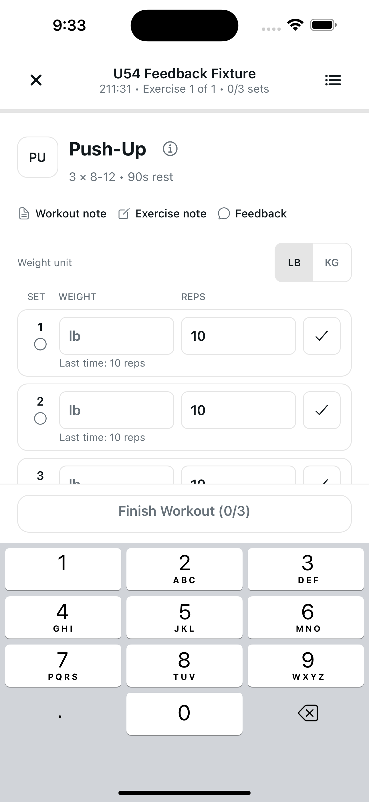
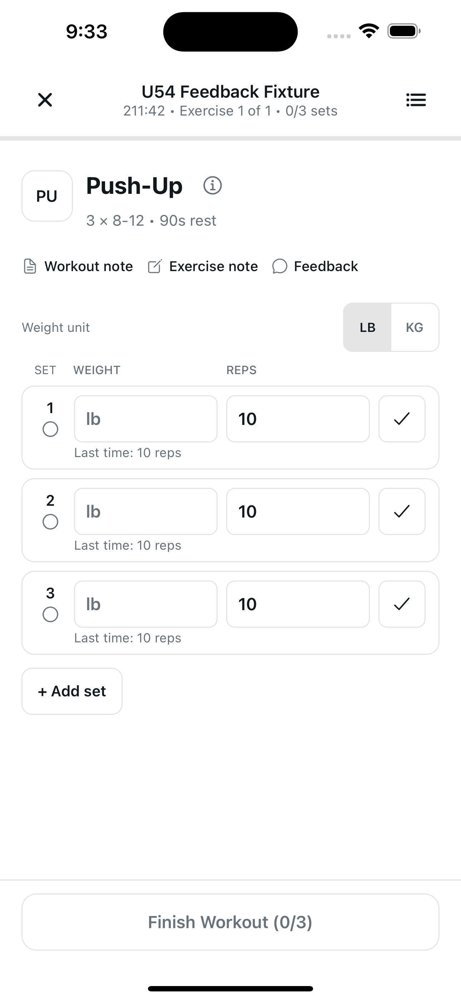
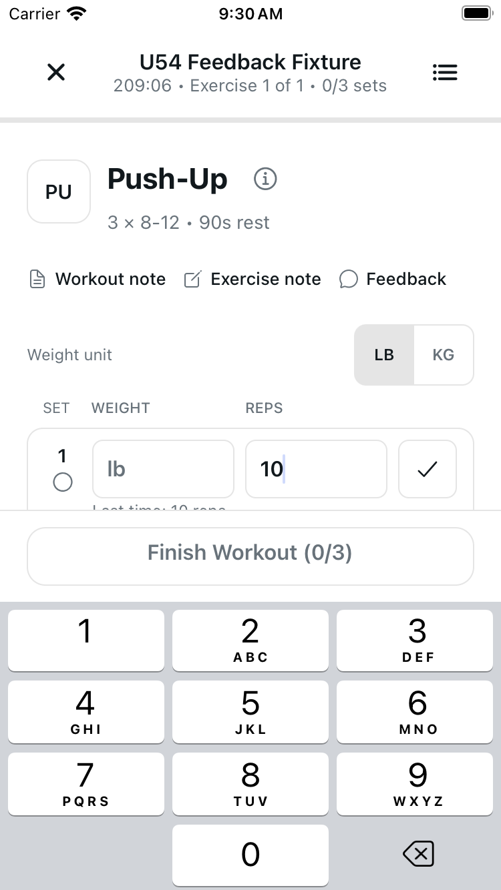
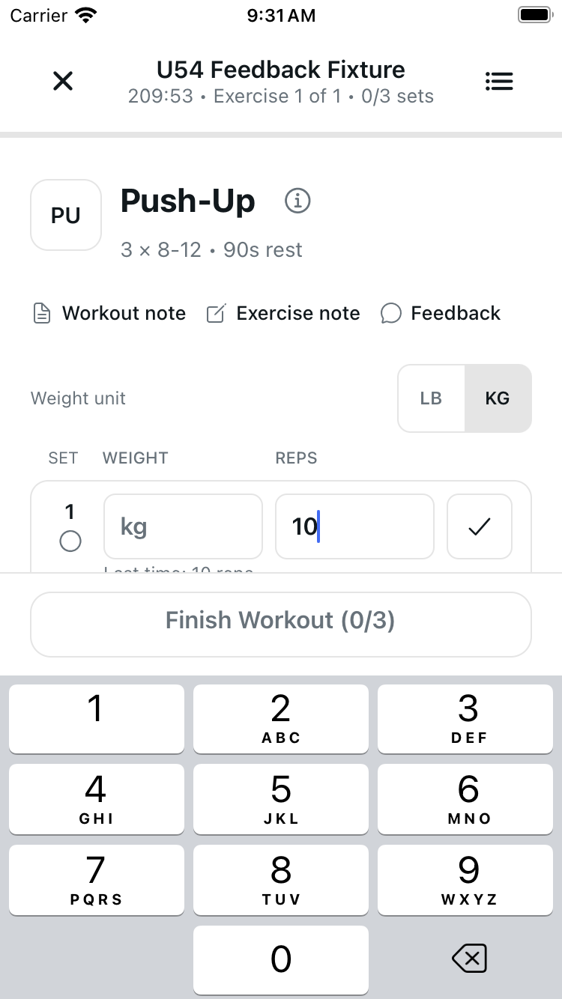

# Workout keyboard: unhandled gutter taps

One main-scroller prop changes from `keyboardShouldPersistTaps="always"` to
`"handled"`. React Native dismisses the keyboard on the verified unhandled gutter
tap while child inputs/controls retain handled taps. There is no visual redesign,
new responder wrapper, or workout-logic change.

## Same action, different result

Both frames are **after the same gutter tap** on SE, Light/normal text: the
original keyboard remains open; the candidate keyboard is dismissed.

| Original after tap | Candidate after tap |
| --- | --- |
|  |  |

## Setup and candidate-only checks

SE before the gutter tap, with a blank weight focused:

| Original setup | Candidate setup |
| --- | --- |
|  |  |

Plus candidate, Light/normal text: same gutter tap dismisses the keyboard.
There is **no original Plus counterpart** in this packet.

| Before tap | After tap |
| --- | --- |
|  |  |

SE: one weight-to-reps tap leaves the visible caret and numeric keyboard active;
one KG tap then selects KG while the keyboard remains. No typing occurred.

| Input-to-input caret | KG selected on first tap |
| --- | --- |
|  |  |

## Verification and boundaries

- Local author and independent: 33 focused cases included within 1,791 standard
  tests; audits/scoped lint pass, two inherited project-lint warnings; web62 pages.
  Typecheck **skipped**, not passed: production imports/types unchanged.
- Reversing the one prop restores the complete original route byte-for-byte,
  including controllers, U54b layout, U54a feedback and all shared dependencies.
- One original SE and two candidate cold device configurations; two before/six
  after raw PNGs. The existing same-candidate input-caret frame was retained
  without repeating the action. No all-fresh/full-matrix claim.
- Unit verification intentionally wrote the local preference LB→KG→LB and may
  trigger ordinary local autosave. Both devices ended LB, keyboard hidden, same
  fictional 0/3 workout, weights unchanged. No Health or server-set write.
- No native Save/typing/drag/finish/durable-transport/VoiceOver/physical-device,
  Android, MAX/Dark matrix or CI certification. Renderer mocks do not execute
  native responder arbitration; the KG tap is not a Save-first-tap test.

Canonical PNG bytes are unedited. Captures preceded commits; file hashes prove
source equivalence, not a post-commit restart. See [provenance](provenance.json).
