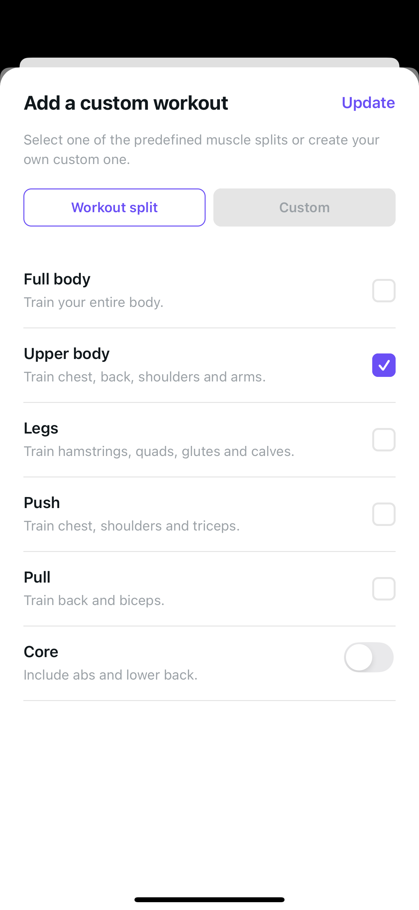
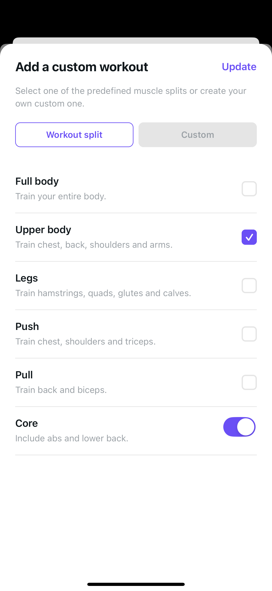

# Core prefill · Workout-split editor

The editor now initializes its selected split from the recognized saved workout. That prevents its first empty-selection effect from overriding the saved Core toggle. Only this initializer changes; hydration/clearing effects, the pure selection handler, Update payload construction, helper/provider code, copy and styling remain unchanged.

## One matched Plus · Light · normal-text pair

Before: the saved Upper body workout has seven muscles including Abs and Lower back, but reopening its editor shows Core off. Dismissing without Update leaves the guest-local saved workout intact. Opening alone is not evidence of persisted-data or database loss.

After: the same saved workout opens with Core on without a Core-switch tap. Exactly one Update retains all seven muscles; reopening still shows Core on in the canonical frame. Deselecting/reselecting Upper temporarily makes Core off, but dismissing without Update leaves the saved seven-muscle workout intact and reopening restores Core on again. Setup, hierarchy and intermediate action frames are excluded from this two-image packet.

| Before | After |
| --- | --- |
|  |  |

Raw PNGs are never resized, cropped or recompressed. Their SHA-256 hashes, bytes, dimensions, source pins and method are in [provenance.json](provenance.json).

## Method and limits

The original runtime serves feature `34b15588`, whose whole tracked tree equals merged main `6407c615`. Candidate captures ran on that base with the two frozen working files. Source milestone `f8b49470`, created after capture, records equivalent file hashes; it was not served during capture, and no separate post-commit restart/capture is implied.

The native scenario is a disposable guest-local draft, not a backend account mutation. Original Update was intentionally not pressed. Candidate acceptance covers exactly one Update/reopen plus temporary deselect/reselect/dismiss and reopen, without additional Update. The modal accessibility tree groups the content and cannot independently establish the native switch's checked value; actual pixels, the visible parent card and reviewed route behavior are the relevant evidence. No accessibility grouping or faded-Update redesign is included.

This is one device class, Light appearance and normal text—not a theme/MAX matrix or physical-device/VoiceOver/keyboard/Android/CI certification. No database, real-disk persistence or network-trace audit is implied. Other screen, service, authentication and Health work is out of scope.

## Local verification

- Original 39 cases passed; the expanded original run had 43 passing controls and 14 intentional red regressions. All 67 candidate cases pass.
- Author passed one 1,746-test standard run; the 67 focused cases are included, not added. Independent review passed the same one full run and focused cases; root accepted all engineering and native gates.
- Scoped lint, UI-action audit/self-tests, syntax and diff checks pass. Project lint has zero errors and two inherited hook warnings.
- Fresh-process web export: 62 HTML pages and 14 exact author source modules; independent review reports 15 explicitly selected modules.
- Type checking intentionally skipped per AGENTS because no import or explicit type changed; this is not a typecheck pass.

Cases cover all five saved split options with Core on/off, create/custom/update payloads and ordering, unmatched/Core-only inputs, explicit deselect/reselect, tabs, cancel, same-batch repeated handlers, gated/already-mounted delayed provider restoration, StrictMode replay and mocked completed-identity handoff. Root hiding/auth/storage are explicitly mocked; ordinary provider-restoration persistence logs are checkpointed, not mistaken for route writes.

Reversing only the approved initializer restores the exact original route/controller. Imports, render/styles, helpers/providers and all six merged U35b source/test pins remain unchanged.

## Rollout dependency

This is a separate functional fix, not U27 presentation work. Merge this PR before opening U27 styling: both will touch the same modal route and regression harness. No force merge, parallel styling overlay or broader Core/selection behavior change is part of this fix. No dependency, configuration, migration or rollout flag changes.
