# U09 — Calmer Program detail and readable training plans

## Summary

Refine only Program detail to match the calmer workout logger and Health connections screens. Keep the program’s real source, prescription, equipment, status and actions unchanged.

- Replace purple day-number tiles, cadence marks and informational metadata with readable neutral treatments.
- Keep **Use this program** and equipment-review actions as the main opaque purple controls. Customize and Edit are neutral; Stop, Cancel next week and Archive retain restrained destructive styling.
- Match Current program and Starts next week badges to ProgramCard’s existing semantic colors, with contrast checks against their actual composited backgrounds.
- Use a compact local header, one complete program name in scrolling content, native uncapped text metrics, wrapping day/exercise metadata, and safe-area-aware bottom spacing. Maximum text uses a controls-only header rather than truncating the title or source.
- Keep loading and Retry calm and scrollable, with a meaningful error icon and unchanged state identifiers.

The design skill informed the restrained hierarchy: the weekly day sequence remains useful information, not decoration, and color is reserved for the main action and meaningful status/error states.

## Screenshots

Original, settled **375-point iPhone SE (3rd generation)** simulator captures. Screenshots are copied byte-for-byte; no fabricated mockups or edited screenshots. The dimmed light-theme capture initially named as a dark top baseline is excluded, so no dark top BEFORE comparison is claimed.

### After — Light

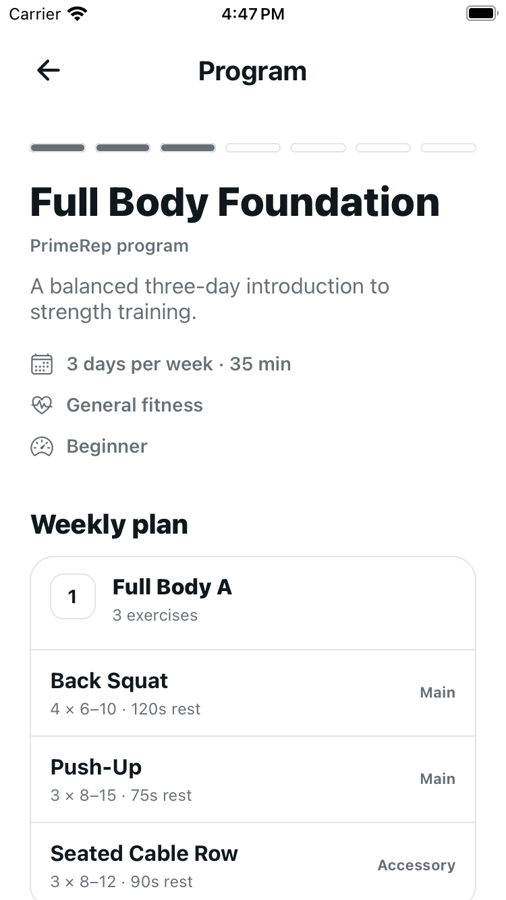
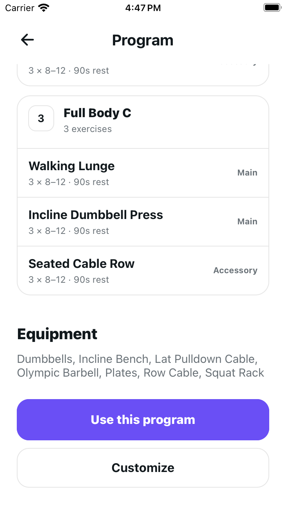

### After — Dark

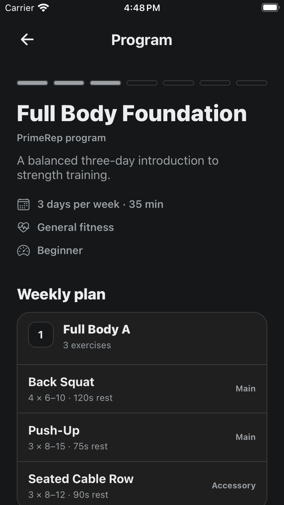
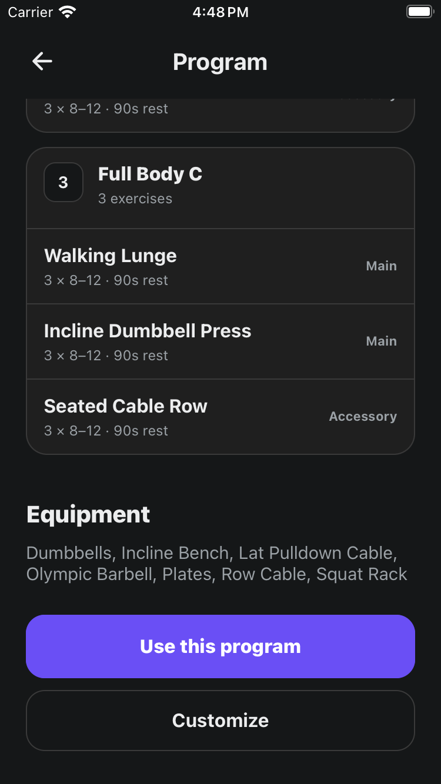

<details>
<summary>Before — original comparison</summary>

Light top and actions:

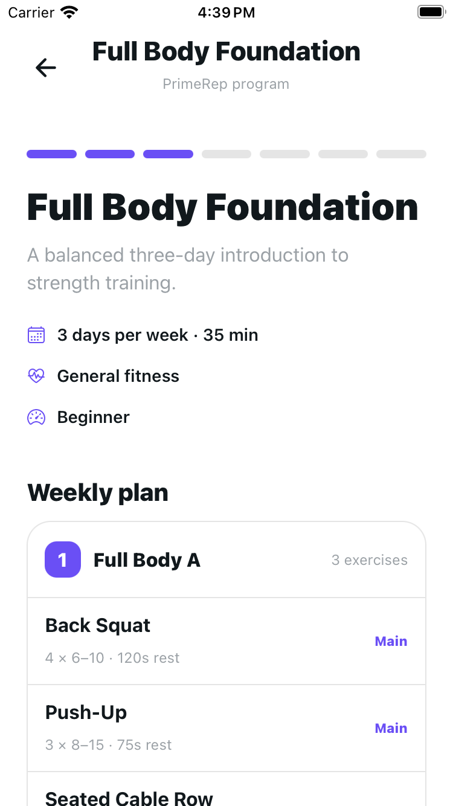
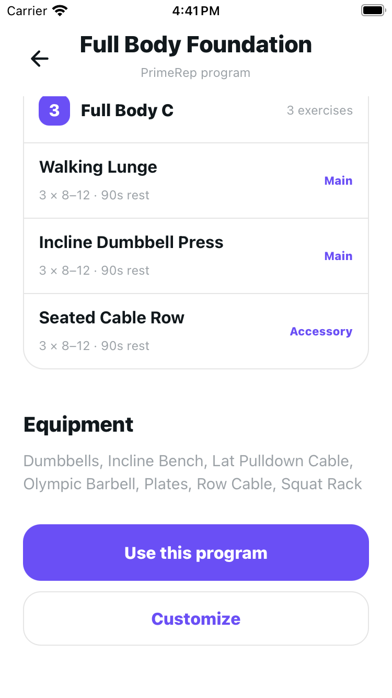

Dark actions:

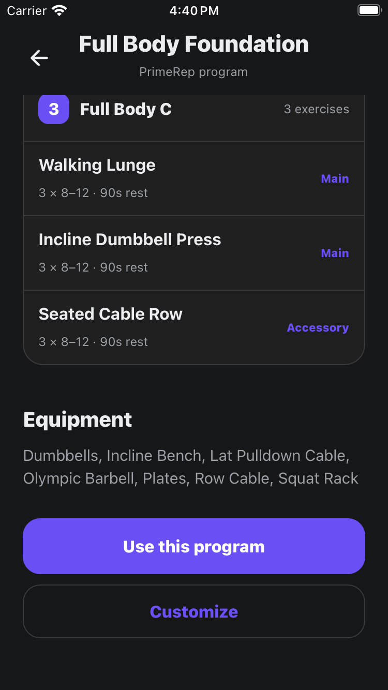

</details>

<details>
<summary>Maximum accessibility text — both themes</summary>

Before: fixed header truncates the program name and source.

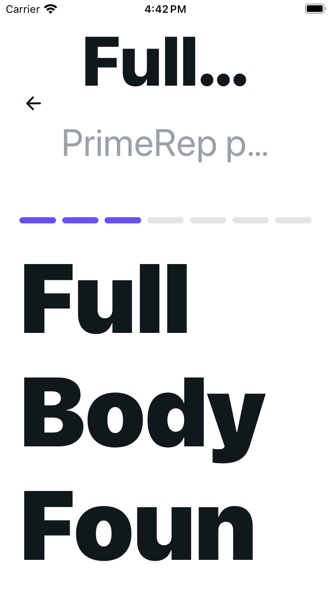
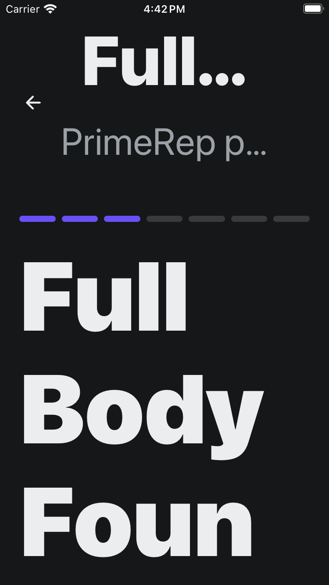

After: compact Back control remains visible; the complete title and source are in scrolling content, and bottom actions wrap inside the screen.

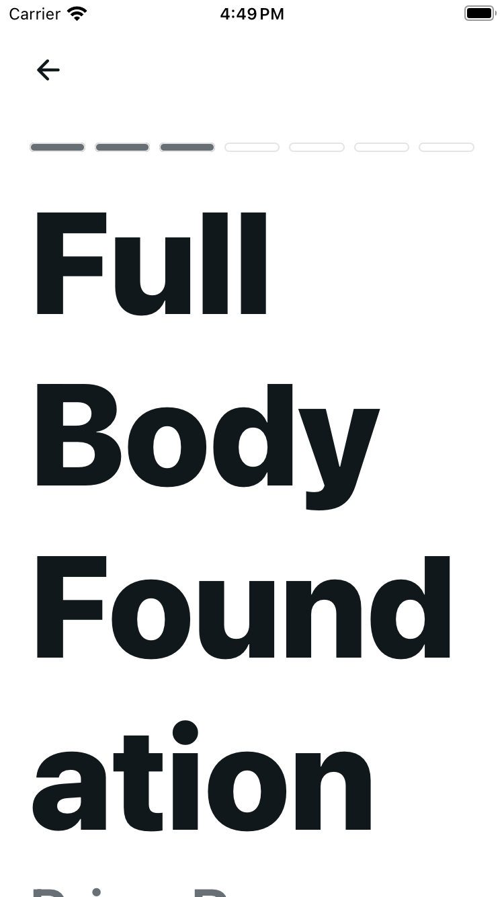
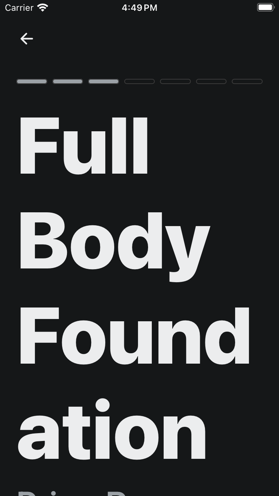
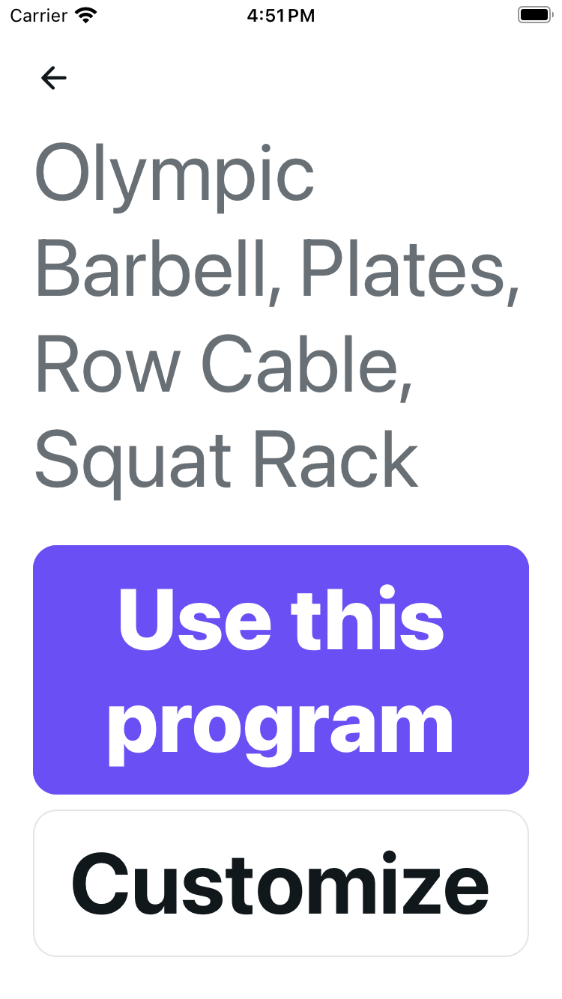
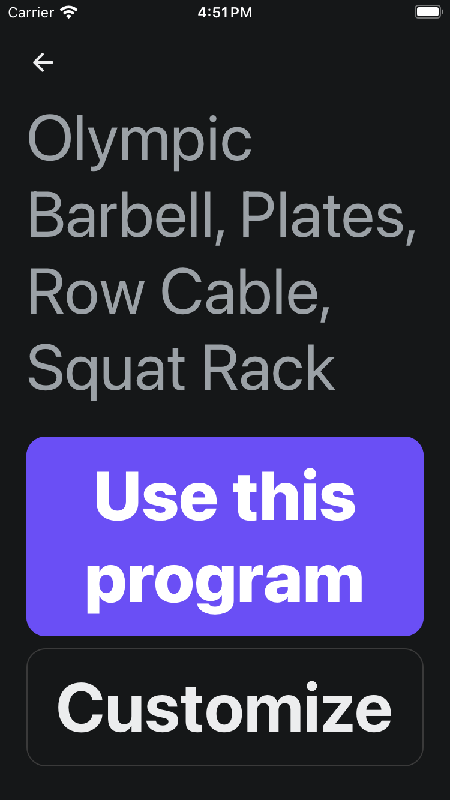

</details>

## Behavior preserved

The complete account/state/request/mutation controller is byte-equivalent to merged `main` at `0f67b24f732fe5d3983c279408330228a6ddbe1d`.

- Program and active-program reads, focus refresh, request/account ownership fencing and stale-response handling.
- System/private source labels; exact prescription text; known and fallback equipment names.
- Use, current/scheduled equipment-review parameters, private Edit, system Customize, private Archive and their original action IDs/accessibility labels.
- Clone, archive, stop and scheduled-cancel confirmation text, service payloads, busy/disabled states, error messages, account/focus/unmount fences, and current-week installation.
- Archive restrictions while active/scheduled; completed history and active-workout snapshots.

No backend/API, migration, database, Health permission/collection/export, storage, shared theme or shared ProgramHeader/ScreenState changes.

## Automated verification

```bash
node --test scripts/test-program-detail-ui.mjs
node --test scripts/test-program-detail-ui.mjs scripts/test-catalog-ui.mjs scripts/test-explore-ui.mjs scripts/test-training-preferences-ui.mjs scripts/test-settings-ui.mjs scripts/test-health-ui.mjs scripts/test-health-export.mjs scripts/test-offline-health-export.mjs scripts/test-health-read-sync.mjs scripts/test-health-account-deletion.mjs scripts/test-offline-finish.mjs scripts/test-workout-set-entries.mjs scripts/test-workout-set-status.mjs scripts/test-profile.mjs scripts/test-exercise-foundation.mjs
npm run lint
npm run typecheck
npm run audit:ui-actions
npm run test:audit-ui-actions
EXPO_PUBLIC_API_URL=https://api.example.invalid npx expo export --platform web --output-dir /private/tmp/primerep-u09-web
git diff --check
```

- **20 focused renderer/action tests** passed. Actual source callbacks run with mocked services and the real local native-scaling text components, not source-only assertions.
- **203 distinct checks** passed in the combined regression command above. Repeated independent runs are not added to the total.
- Lint, typecheck, UI-action audit and its self-tests passed. HTTPS-configured web export completed for **62 routes**.
- Contrast is checked in both themes for muted metadata, opaque/pressed primary actions, neutral/pressed secondary actions, disabled controls, destructive/error colors, and actual composited status badges.
- Handler checks cover loading/error/retry, source and bodyweight fallback, long/max text, all routes/review parameters, clone/busy/failure retry, private edit/archive/409, stop/week install, scheduled cancel, delayed account/route responses and in-flight mutation account switches.

Existing nonblocking tooling messages: React Test Renderer deprecation, baseline-browser-mapping age, NO_COLOR/FORCE_COLOR precedence and web push-token listener limitation. No dependency updates are included.

## Native verification

Read-only native checks use the existing Full Body Foundation system program (3 days / 35 minutes) on the usual local environment. The flow browses through the catalog, checks source/prescriptions/equipment and both action labels, then returns Home without activation, Customize, Save or destructive actions.

- The dedicated `.maestro/program-detail-refinement.yaml` flow passed in both Light and Dark at normal text size.
- Separate bounded maximum-text checks confirmed the complete program title/source can scroll, Back remains visible, and both bottom actions are fully readable/reachable in both themes. These are separate checks, not a claim that the normal flow passed at maximum text size.
- Original screenshots were visually reviewed in both themes at normal and maximum text size.
- Native bounds: Back is **44 × 44 points** and the compact header **64 points** high at normal and maximum text. At maximum text, the complete hero title fits the **331-point** content width, source copy scrolls, and the visible Use / Customize actions grow to **331 × 166** / **331 × 99 points** rather than clipping.
- Maximum-text day/count, exercise name, prescription and block metadata remain contained in their cards; these checks use normal scrolling without font caps or screenshot manipulation.
- Simulator restored to **Light / normal Large text / Home**. The original Upper A **4/4** active workout and Resume action remain. No activation, clone, save, archive, stop, cancellation, permission or Health-data mutation was performed.

## Known gaps and release boundaries

Private/current/scheduled/review, mutation failure and account-race variants are automated with mocked source callbacks; native mutating actions are deliberately not run against the existing fixture. Physical iPhone, VoiceOver and signed-release acceptance remain manual checks. This styling PR does not close Part 9 infrastructure or Part 10 production/Android release gates.

## Dependencies and rollout

Based on updated `main` after Training Preferences PR #57. Profile PR #55 remains separate; no dependency on its unmerged changes.

Ship through the usual frontend/native bundle rollout. No backend rollout or migration is required. Roll back this screen, its focused tests and read-only QA documentation together if needed. Keep the PR unmerged until screenshot/design acceptance.
