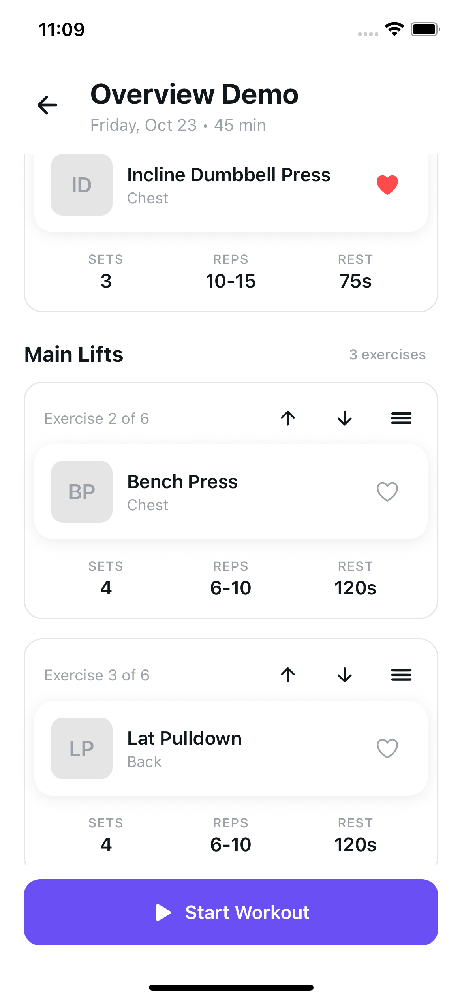
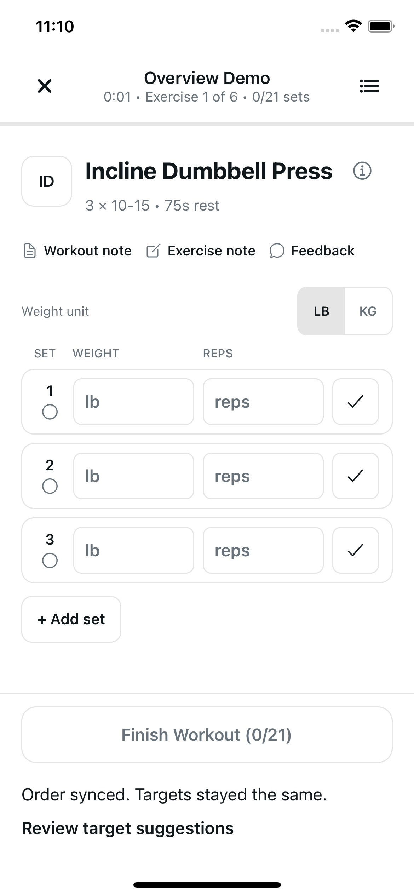

# Exercise ordering and replacement

Users can choose exercise order directly on the workout overview before pressing
Start, then arrange exercises or replace an eligible exercise during the workout.
The player,
resume banner, completed summary, and history use `effectiveWorkout`, falling
back to `workoutSnapshot`. The original snapshot remains available as provenance;
the weekly plan and authored program are never changed.

## Before Start

The workout overview cards have drag handles, visible move buttons, and screen
reader move actions. Measured card positions support moves across role sections;
holding the handle near the list edge scrolls it during a drag. Section headings
follow the chosen sequence, including a role that appears more than once.

The selected order is saved locally per account and workout day. Moving a card
does not create an active draft, session, or timer and does not call the session
API. Navigation and app restart preserve it. Changes to the source exercises,
prescriptions, or program version invalidate an obsolete order; harmless image
or descriptive metadata changes do not.

Start claims the active slot and durably queues creation followed by the chosen
order with existing targets. The chosen first exercise opens immediately, and
supported target suggestions can be reviewed after synchronization. A matching
active workout retains its current exercise, saved sets, and rest timer while
the order changes through the existing revision checks. Changed exercise
membership requires explicit resume and review. Completed sessions cannot be
resurrected by a late Start operation.

## During the workout

The exercise sheet offers drag handles, visible Move up/down buttons, and screen
reader move actions. Before any set is saved, the new first exercise opens.
After logging starts, the current exercise and running rest period retain their
exercise IDs while the next-up sequence follows the new order.

An online order preview shows supported main/accessory target changes. Users
can apply those targets or keep their existing targets. Entered or edited set
values suppress revised targets. Replacement requires a connection and a flush
of pending set writes. A source with any saved or pending set is protected;
unsaved entries require the explicit **Discard entries and replace** confirmation.
Candidate guidance uses the existing full-height exercise information sheet.

## Recovery

Native SQLite and web AsyncStorage persist the effective workout, revision,
current/rest exercise IDs, and ordered operations before a mutation is sent.
An attempted operation retains its ID and payload through timeout retries.
Offline reorders keep targets, sync automatically after reconnect, and preserve
an optional target-review prompt through restart. Keeping or applying targets
clears that prompt. A revision conflict fetches the authoritative workout and
retains the pending order for explicit review. If another device replaced an
exercise, use the latest workout before reordering again.

## Verification and rollout

- `node --test scripts/test-workout-arrangement-ui.mjs scripts/test-workout-arrangement-store.mjs scripts/test-workout-arrangement-player.mjs`
  checks UI callbacks, accessible and drag moves, typed entry protection,
  replacement confirmation, native/web restart and replay, conflicts, immutable
  provenance and server-owned resume. The mounted-player tests exercise real web
  persistence and hook integration through background replay/autosave, including
  replacement set hydration and single-modal handoffs to review and guidance.
- `node --test scripts/test-workout-detail-ui.mjs scripts/test-workout-set-entries.mjs scripts/test-settings-ui.mjs`
  checks the mounted overview's direct card gestures and controls, pre-start
  persistence and Start handoff, route/account cancellation, terminal-session
  protection, existing logging behavior, and deleted-account cleanup.
- Existing workout set-entry, correction and summary UI suites check logging
  and completed review regressions.
- Run `npm run typecheck`, `npm run lint`, and an Expo web export. Device gesture,
  layout and screen reader checks require native runtime verification; JS mocks
  alone do not prove those behaviors on a physical device.

Deploy backend [PR 27](https://github.com/DiegoZG/PrimeRep-AI-Backend/pull/27)
and migration `a2b3c4d5e6f7` before distributing this client. Arrangement controls
are absent when the session response lacks `arrangementRevision`, allowing the
new client to keep logging against older API deployments.

## Runtime evidence

Verified on October 23, 2026 using fictional accounts, a disposable PostgreSQL
database, and an isolated API. Existing user accounts, services, and simulator
data were preserved.

- **Before Start, iOS 18.5, compact iPhone 16e simulator:** an actual handle
  drag with edge auto-scroll moved the fourth accessory exercise into first
  position across role sections. The overview retained its Start footer and
  original sets, reps, and rest. After the drag and a process restart, the API
  reported zero sessions and native SQLite had zero active workouts or timers.
  Reopening the overview restored the chosen order. Favoriting the exercise
  and opening its detail screen still worked and retained the order on return.
  Pressing Start then opened the chosen first exercise with its three original
  set rows. The server had exactly one session at revision one with the chosen
  six-exercise order and twenty-one target sets; its original snapshot and
  weekly workout remained unchanged.
- **iOS 18.5, iPhone 16 Plus simulator:** visible Move up/down controls and an
  actual handle drag opened the generated-target preview. Both Keep current
  targets and Apply revised targets saved successfully; moving a new exercise
  first opened it with the revised set rows.
- **Replacement:** typed entries required explicit discard confirmation.
  Exercise guidance opened, its Close control was individually accessible,
  and closing guidance returned to confirmation. Replacing the open exercise
  in position two retained that position, all four replacement rows, and
  fourteen total sets, without a stale pending replacement. The original
  server snapshot remained unchanged.
- **Saved sets and rest:** after logging one fictional set, replacement was
  disabled. Reordering the current exercise retained its saved set and running
  rest timer. At the system accessibility-large text setting, the exercise list
  scrolled and its move controls and disabled replacement remained reachable.
- **Actual offline interruption:** stopping only the isolated API allowed an
  order change to save locally with targets unchanged. After terminating and
  reopening the app while still offline, the order, current exercise, saved
  set, and rest timer survived in real SQLite. Restoring the API automatically
  synced the same operation: server and SQLite advanced to revision five,
  the queue emptied, and optional target review remained available.
- **Web:** an in-app browser fixture passed target preview/apply, replacement
  in position two with four replacement rows and fourteen total sets, reload
  and resume, replacement protection after logging, and reordering while the
  current exercise and rest timer remained stable.

Independent focused verification passed **188 tests** across the mounted
overview, arrangement UI and player integration, native/web persistence,
set-entry behavior, and settings cleanup. Type checking, targeted lint, and the
62-route Expo web export also passed. Backend verification is recorded in PR 27.

Android runtime checks could not run because no Android SDK or emulator was
available. Physical-device and full VoiceOver gesture checks
remain unverified; native accessibility control discovery was checked through
the simulator hierarchy. Revision conflict and timeout retries were exercised
by the executable native/web persistence harnesses, without a live second
device. The new overview gestures were checked on the native simulator and
mounted harness; the browser runtime checks above cover the active player.
These checks did not deploy the app or API.

### Passing iOS captures

